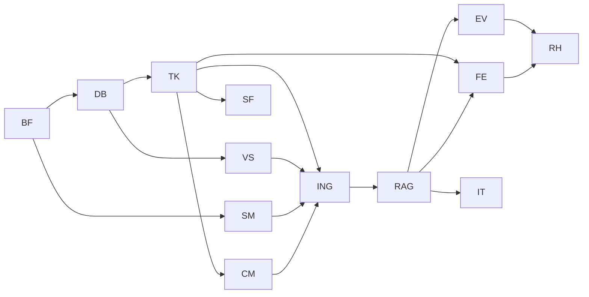

# c2-ticket.ai — Implementation Plan

**Sources:** `spec/`, `rules/`, `commands/`  
**Type:** Sequenced, independently testable tasks (no application code in this document)  
**Stack:** Java 17, Spring Boot 3.5.x, PostgreSQL + PGVector, Ollama (dev LLM + embeddings), frontend TBD (Vitest per [test-strategy.md](../spec/test-strategy.md))

---

## Plan assumptions (locked for implementation)

| Assumption | Reference |
|------------|-----------|
| `Comment.id` is a **UUID** (string in JSON) | [data-model.md](../spec/data-model.md) |
| `title` **required** on create; `priority` defaults to **`MEDIUM`** | [data-model.md](../spec/data-model.md), [api-contract.md](../spec/api-contract.md) |
| Client-supplied **`ticketId` on create** → **400** | [api-contract.md](../spec/api-contract.md) |
| **Status change** triggers **full re-ingest** for that ticket | [rag-ingestion.md](../spec/rag-ingestion.md), [state-machine.md](../spec/state-machine.md) |
| **Citation `title`** resolved from **ticket store**, not model text | [rag-api-contract.md](../spec/rag-api-contract.md) |
| Dev **LLM:** Ollama **`llama3.2`** | Plan assumption (generation); embeddings unchanged |
| Dev **embeddings:** Ollama **`nomic-embed-text`**, dim **768** | [rag-ingestion.md](../spec/rag-ingestion.md) |
| **No auth** in v1 | [api-contract.md](../spec/api-contract.md) |
| List API: **filters only**; **no pagination**; **no server keyword search** | [api-contract.md](../spec/api-contract.md), [ui-flow.md](../spec/ui-flow.md) |

---

## Out of scope (v1)

Authentication, pagination, ticket delete, a **second** vector database, **cloud embeddings in dev**.

---

## Task template

Each task includes: **ID**, **description**, **files**, **dependencies**, **acceptance criteria**, **tests**.

Dependencies use task IDs (e.g. `BF-1`). “—” = none.

---

## Workstream BF — Foundation

### BF-1 — Maven/Gradle project skeleton

| Field | Content |
|-------|---------|
| **Description** | Spring Boot 3.5.x app, Java 17, packages per [java-springboot.md](../rules/java-springboot.md). |
| **Files** | `pom.xml` or `build.gradle.kts`, `src/main/java/com/example/.../Application.java`, `src/main/resources/application.yml`, `src/test/resources/application-test.yml` |
| **Dependencies** | — |
| **Acceptance** | App starts; `test` profile loads; packages `com.example.ticket.*`, `com.example.rag.*`, `com.example.config` exist. |
| **Tests** | Context loads smoke test (`@SpringBootTest` or slice). |

### BF-2 — Global API config

| Field | Content |
|-------|---------|
| **Description** | `/api/v1` prefix, JSON, Jackson unknown-property failure for ticket DTOs. |
| **Files** | `com.example.config.WebConfig`, `com.example.config.JacksonConfig` |
| **Dependencies** | BF-1 |
| **Acceptance** | Unknown JSON property on ticket create → 400 `VALIDATION_ERROR` ([api-standards.md](../rules/api-standards.md)). |
| **Tests** | MockMvc: POST ticket with extra field → 400. |

### BF-3 — Error envelope handler

| Field | Content |
|-------|---------|
| **Description** | `@ControllerAdvice` maps exceptions to ticket error envelope. |
| **Files** | `com.example.ticket.api.ApiExceptionHandler`, `com.example.ticket.api.ErrorResponse` record |
| **Dependencies** | BF-2 |
| **Acceptance** | Shape `{ error: { code, message, details[] } }`; `details` never missing. |
| **Tests** | MockMvc asserts envelope on 404/400 stubs. |

### BF-4 — RAG configuration properties

| Field | Content |
|-------|---------|
| **Description** | `@ConfigurationProperties` for `rag.chunk`, `rag.embedding`, `rag.retrieval`, `rag.ingestion`. |
| **Files** | `com.example.rag.config.RagChunkProperties`, `RagEmbeddingProperties`, `RagRetrievalProperties`, `RagIngestionProperties`, `RagConfig` |
| **Dependencies** | BF-1 |
| **Acceptance** | Defaults in yml: `top-k: 5`, `similarity-threshold: 0.72`, chunk max-chars 2000, overlap 250 ([rag-ingestion.md](../spec/rag-ingestion.md)). |
| **Tests** | `@SpringBootTest` binds properties from `application-test.yml`. |

### BF-5 — Test profile infrastructure

| Field | Content |
|-------|---------|
| **Description** | H2, Flyway **off**, Hibernate `create-drop`, embedding/generator test fakes beans. |
| **Files** | `application-test.yml`, `com.example.config.TestDoublesConfig` |
| **Dependencies** | BF-1, BF-4 |
| **Acceptance** | `mvn test` needs no Ollama/Postgres ([testing.md](../rules/testing.md)). |
| **Tests** | Default surefire green (smoke). |

---

## Workstream DB — Flyway (runtime / dev Postgres)

### DB-1 — Enable Flyway for non-test profiles

| Field | Content |
|-------|---------|
| **Description** | Flyway on `dev`/`prod`; test profile remains Flyway off per BF-5. |
| **Files** | `application-dev.yml`, `pom.xml` flyway dependency |
| **Dependencies** | BF-1 |
| **Acceptance** | `spring.profiles.active=dev` runs migrations on startup. |
| **Tests** | Optional Testcontainers migration smoke (IT workstream). |

### DB-2 — Ticket and comment tables

| Field | Content |
|-------|---------|
| **Description** | DDL matching [data-model.md](../spec/data-model.md); indexes locked in spec. |
| **Files** | `src/main/resources/db/migration/V1__tickets_comments.sql` |
| **Dependencies** | DB-1 |
| **Acceptance** | `ticket` (surrogate `id` + `ticket_id` UK); `comment` (`id` UUID, FK `ticket_id`); indexes on status, priority, assignee, category, (status, created_at). |
| **Tests** | Flyway migrate on Testcontainers Postgres (IT-1). |

### DB-3 — Ticket ID sequence

| Field | Content |
|-------|---------|
| **Description** | Sequence starting at **1001** for `TKT-{n}` allocation. |
| **Files** | `V2__ticket_id_sequence.sql`, `com.example.ticket.service.TicketIdGenerator` |
| **Dependencies** | DB-2, TK-1 (generator used in service) |
| **Acceptance** | First id `TKT-1001`; regex `^TKT-[0-9]+$`; concurrent creates unique. |
| **Tests** | Integration or service test with sequence. |

---

## Workstream SM — State machine

### SM-1 — TicketStatusTransitionPolicy

| Field | Content |
|-------|---------|
| **Description** | Pure domain policy; matrix per [state-machine.md](../spec/state-machine.md). |
| **Files** | `com.example.ticket.domain.TicketStatus`, `TicketStatusTransitionPolicy` |
| **Dependencies** | BF-1 |
| **Acceptance** | 5 legal edges allow; same-state and terminal reject; no framework imports. |
| **Tests** | Parameterized unit tests §7.1 tables ([state-machine.md](../spec/state-machine.md)). |

### SM-2 — TicketStatusTransitionService

| Field | Content |
|-------|---------|
| **Description** | Load ticket, policy before persist, update status + `updatedAt`, trigger ingest hook (stub until ING). |
| **Files** | `com.example.ticket.service.TicketStatusTransitionService` |
| **Dependencies** | SM-1, TK-2 (repository), ING-8 (ingest hook interface) |
| **Acceptance** | Illegal transition: no row change; legal: status persisted. |
| **Tests** | `@DataJpaTest` or service test + H2. |

### SM-3 — Status PATCH controller

| Field | Content |
|-------|---------|
| **Description** | `PATCH /api/v1/tickets/{ticketId}/status` only path mutating status. |
| **Files** | `com.example.ticket.api.TicketStatusController` or methods on `TicketController` |
| **Dependencies** | SM-2, BF-3 |
| **Acceptance** | 400 `INVALID_STATUS_TRANSITION`; 404 `TICKET_NOT_FOUND`. |
| **Tests** | MockMvc matrix from [state-machine.md](../spec/state-machine.md) §7.3. |

---

## Workstream TK — Ticket CRUD

### TK-1 — JPA entities and repository

| Field | Content |
|-------|---------|
| **Description** | Ticket entity (internal id not exposed); Spring Data repository by `ticketId`. |
| **Files** | `com.example.ticket.repository.TicketEntity`, `TicketRepository` |
| **Dependencies** | BF-5 (H2 schema) or DB-2 |
| **Acceptance** | Fields match data-model; no `id` in API layer. |
| **Tests** | Repository save/find. |

### TK-2 — TicketMapper / response records

| Field | Content |
|-------|---------|
| **Description** | Record `TicketResponse` per [api-contract.md](../spec/api-contract.md). |
| **Files** | `com.example.ticket.api.dto.*` |
| **Dependencies** | TK-1 |
| **Acceptance** | All public fields present; camelCase. |
| **Tests** | Mapper unit test. |

### TK-3 — Create ticket

| Field | Content |
|-------|---------|
| **Description** | `POST /api/v1/tickets`; reject `ticketId`/`status`; OPEN + generated id; default MEDIUM. |
| **Files** | `TicketController`, `TicketCreateRequest`, `TicketService` |
| **Dependencies** | TK-1, TK-2, DB-3, BF-3, ING-8 |
| **Acceptance** | 201 + ticket; client `ticketId` → 400. |
| **Tests** | MockMvc create happy path + rejection cases ([api-contract.md](../spec/api-contract.md) §4.1). |

### TK-4 — Get ticket by id

| Field | Content |
|-------|---------|
| **Description** | `GET /api/v1/tickets/{ticketId}`. |
| **Files** | `TicketController`, `TicketService` |
| **Dependencies** | TK-2 |
| **Acceptance** | 200 / 404 `TICKET_NOT_FOUND`. |
| **Tests** | MockMvc. |

### TK-5 — Partial update ticket

| Field | Content |
|-------|---------|
| **Description** | `PATCH /api/v1/tickets/{ticketId}`; forbid `status` field. |
| **Files** | `TicketPatchRequest`, `TicketService` |
| **Dependencies** | TK-2, BF-3, ING-8 |
| **Acceptance** | 400 `STATUS_CHANGE_NOT_ALLOWED_ON_THIS_ENDPOINT` if `status` in body. |
| **Tests** | MockMvc PATCH with/without status. |

---

## Workstream CM — Comments

### CM-1 — Comment entity and repository

| Field | Content |
|-------|---------|
| **Description** | UUID primary key; FK on `ticketId`. |
| **Files** | `CommentEntity`, `CommentRepository` |
| **Dependencies** | TK-1, DB-2 |
| **Acceptance** | Cannot persist comment for missing ticket. |
| **Tests** | Repository + FK constraint. |

### CM-2 — Comment API

| Field | Content |
|-------|---------|
| **Description** | POST 201, GET chronological asc. |
| **Files** | `CommentController`, `CommentService`, DTO records |
| **Dependencies** | CM-1, TK-4, ING-8, BF-3 |
| **Acceptance** | `id` UUID string in JSON; parent 404. |
| **Tests** | MockMvc POST/GET order assertion. |

---

## Workstream SF — List filters

### SF-1 — Ticket list query

| Field | Content |
|-------|---------|
| **Description** | `GET /api/v1/tickets` with AND filters: status, priority, assignee, category only. |
| **Files** | `TicketRepository` query method or spec, `TicketController` |
| **Dependencies** | TK-1, TK-2 |
| **Acceptance** | No pagination; full array; invalid enum → 400. |
| **Tests** | MockMvc multi-filter AND; assert no `keyword` param handled. |

---

## Workstream VS — PGVector

### VS-1 — PGVector migration

| Field | Content |
|-------|---------|
| **Description** | Extension + `ticket_chunk` table `vector(768)`, HNSW `vector_cosine_ops`. |
| **Files** | `V3__pgvector_ticket_chunk.sql` |
| **Dependencies** | DB-1 |
| **Acceptance** | Matches [rag-ingestion.md](../spec/rag-ingestion.md) §6. |
| **Tests** | IT migrate on Postgres with pgvector image. |

### VS-2 — TicketChunk repository

| Field | Content |
|-------|---------|
| **Description** | JPA/native queries: delete by `ticket_id`, similarity search ORDER BY distance LIMIT k. |
| **Files** | `com.example.rag.retrieval.TicketChunkEntity`, `TicketChunkRepository` |
| **Dependencies** | VS-1 |
| **Acceptance** | Uses `<=>`; similarity **s = 1 - distance** in service layer. |
| **Tests** | Testcontainers or in-memory fake for unit; IT for native query. |

### VS-3 — In-memory vector store (test)

| Field | Content |
|-------|---------|
| **Description** | Fake implementing same port as VS-2 for default tests. |
| **Files** | `com.example.rag.retrieval.InMemoryVectorStore` (test/main test-only bean) |
| **Dependencies** | BF-5 |
| **Acceptance** | Default `mvn test` never requires PGVector. |
| **Tests** | Used by retrieval/ingestion tests. |

---

## Workstream ING — Ingestion

### ING-1 — Knowledge document builder

| Field | Content |
|-------|---------|
| **Description** | Template §3 [rag-ingestion.md](../spec/rag-ingestion.md); omit blank sections. |
| **Files** | `com.example.rag.ingestion.KnowledgeDocumentBuilder` |
| **Dependencies** | TK-1, CM-1 |
| **Acceptance** | Comments chronological one-liners. |
| **Tests** | Unit test with fixture ticket + comments. |

### ING-2 — Section-v1 chunker

| Field | Content |
|-------|---------|
| **Description** | Single chunk if doc ≤ max-chars; else section split + overflow overlap; prefix `[Ticket …]`. |
| **Files** | `com.example.rag.ingestion.SectionV1Chunker` |
| **Dependencies** | BF-4, ING-1 |
| **Acceptance** | `chunker_version` = `section-v1`; uses **characters** not tokens. |
| **Tests** | Unit: small doc → 1 chunk; oversized comment → multiple with overlap. |

### ING-3 — Fingerprint and skip

| Field | Content |
|-------|---------|
| **Description** | Hash content + metadata + chunker + model; skip embed/replace if ordered fingerprints match. |
| **Files** | `com.example.rag.ingestion.ChunkFingerprintService` |
| **Dependencies** | ING-2 |
| **Acceptance** | No-op second ingest when unchanged. |
| **Tests** | Unit + fake vector store call count. |

### ING-4 — Ollama embedding client (dev)

| Field | Content |
|-------|---------|
| **Description** | HTTP client to `localhost:11434`, `nomic-embed-text`, dim 768. |
| **Files** | `com.example.rag.ingestion.OllamaEmbeddingClient`, `EmbeddingPort` interface |
| **Dependencies** | BF-4 |
| **Acceptance** | Same port used for query embedding (RAG). |
| **Tests** | Fake in test profile; optional IT with Ollama gated. |

### ING-5 — Ingestion replace transaction

| Field | Content |
|-------|---------|
| **Description** | After successful embed: DELETE all chunks for `ticketId` + INSERT in one TX; empty doc → delete only. |
| **Files** | `com.example.rag.ingestion.TicketIngestionService` |
| **Dependencies** | ING-2, ING-3, ING-4, VS-2 |
| **Acceptance** | Embed failure: log, old vectors kept ([rag-ingestion.md](../spec/rag-ingestion.md) ING-D-2). |
| **Tests** | Integration with in-memory or Testcontainers. |

### ING-6 — Post-commit ingest hook

| Field | Content |
|-------|---------|
| **Description** | Register after-success callbacks from ticket/comment/status services. |
| **Dependencies** | ING-5, TK-3, TK-5, SM-2, CM-2 |
| **Acceptance** | Triggers on create, field update, comment add, **status change** (full re-ingest). |
| **Tests** | Spy: status PATCH invokes ingest once. |

### ING-8 — Ingestion port (stub for early tasks)

| Field | Content |
|-------|---------|
| **Description** | Interface `TicketIngestionPort.ingest(ticketId)` for SM/TK before ING-5 complete. |
| **Files** | `com.example.rag.ingestion.TicketIngestionPort`, `NoOpTicketIngestion` → real impl ING-5 |
| **Dependencies** | BF-1 |
| **Acceptance** | Wired in constructor injection. |
| **Tests** | Mock in unit tests until ING-5. |

---

## Workstream RAG — Query API

### RAG-1 — RagRetrievalService

| Field | Content |
|-------|---------|
| **Description** | Embed query → top-K → threshold → keep-set; **no literals 5/0.72** in class body. |
| **Files** | `com.example.rag.retrieval.RagRetrievalService` |
| **Dependencies** | BF-4, ING-4, VS-2 or VS-3 |
| **Acceptance** | Order per [rules/rag-vector-store.md](../rules/rag-vector-store.md). |
| **Tests** | Change `application-test.yml` k/threshold → different keep-set. |

### RAG-2 — Ollama generation client (dev)

| Field | Content |
|-------|---------|
| **Description** | Dev LLM **`llama3.2`**; prompt includes §8.1 verbatim ([rag-api-contract.md](../spec/rag-api-contract.md)). |
| **Files** | `com.example.rag.generation.OllamaChatClient`, `GenerationPort`, `RagPromptBuilder` |
| **Dependencies** | BF-4 |
| **Acceptance** | Prompt diff test against spec §8.1 five lines. |
| **Tests** | Unit: prompt content; fake client in default suite. |

### RAG-3 — Post-generation gate

| Field | Content |
|-------|---------|
| **Description** | Foreign `TKT-*` in answer; duration contradiction vs context. |
| **Files** | `com.example.rag.review.PostGenerationGate` |
| **Dependencies** | — |
| **Acceptance** | Fail → downstream treats as NO_MATCH, not ANSWER. |
| **Tests** | Unit: 30 min context + 24 h answer → fail. |

### RAG-4 — Citation assembler

| Field | Content |
|-------|---------|
| **Description** | Distinct ticket IDs from keep-set; sort sim desc, ticketId asc; **title from ticket store**. |
| **Files** | `com.example.rag.service.CitationAssembler` |
| **Dependencies** | TK-1, RAG-1 |
| **Acceptance** | Citations ∉ keep-set impossible. |
| **Tests** | Unit with mocked repository titles. |

### RAG-5 — RAG orchestrator and controller

| Field | Content |
|-------|---------|
| **Description** | Empty keep-set → no LLM, full envelope NO_MATCH; ANSWER/ERROR paths. |
| **Files** | `com.example.rag.service.RagQueryService`, `com.example.rag.api.RagQueryController` |
| **Dependencies** | RAG-1–RAG-4, BF-3 (RAG envelope handler separate if needed) |
| **Acceptance** | [rag-api-contract.md](../spec/rag-api-contract.md) keys always present; blank query 400. |
| **Tests** | MockMvc envelope; verify generator not called when keep-set empty. |

---

## Workstream EV — Evaluation

### EV-1 — Golden eval test runner

| Field | Content |
|-------|---------|
| **Description** | Load `src/test/resources/eval/*.json`; drive stubs per [evaluation-strategy.md](../spec/evaluation-strategy.md). |
| **Files** | `src/test/java/.../eval/GoldenEvalIT.java` |
| **Dependencies** | RAG-5, RAG-3 |
| **Acceptance** | `hallucination-duration-expiry.json` → NO_MATCH, never ANSWER. |
| **Tests** | Self (golden cases). |

### EV-2 — Contract assertion helpers

| Field | Content |
|-------|---------|
| **Description** | Assert ticket error envelope and RAG full envelope keys. |
| **Files** | `src/test/java/.../support/ContractAssertions.java` |
| **Dependencies** | BF-3, RAG-5 |
| **Acceptance** | Used by MockMvc and eval tests. |
| **Tests** | Meta-tests on sample JSON fixtures. |

---

## Workstream FE — Frontend

### FE-1 — App shell and routes

| Field | Content |
|-------|---------|
| **Description** | Home → `/tickets`; nav Tickets + Ask AI ([ui-flow.md](../spec/ui-flow.md)). |
| **Files** | `frontend/src/router`, `App.vue` or equivalent |
| **Dependencies** | — |
| **Acceptance** | No auth UI; no pagination UI. |
| **Tests** | Vitest route tests. |

### FE-2 — Ticket list + API filters

| Field | Content |
|-------|---------|
| **Description** | Columns: ticketId, title, status, priority, assignee, createdAt; AND filters to API. |
| **Files** | `frontend/src/views/TicketList.vue` |
| **Dependencies** | FE-1, SF-1 (API live or mocked) |
| **Acceptance** | Keyword filter **client-only** on fetched rows. |
| **Tests** | Vitest: keyword does not alter fetch URL. |

### FE-3 — Create and detail

| Field | Content |
|-------|---------|
| **Description** | Create form; detail edit + resolution notes; status buttons per matrix only. |
| **Files** | `TicketCreate.vue`, `TicketDetail.vue` |
| **Dependencies** | FE-1, TK-3, TK-5, SM-3 |
| **Acceptance** | Status via status endpoint only; show `INVALID_STATUS_TRANSITION`. |
| **Tests** | Vitest button visibility by status. |

### FE-4 — Comments UI

| Field | Content |
|-------|---------|
| **Description** | List + add comment on detail. |
| **Files** | `CommentList.vue` component |
| **Dependencies** | FE-3, CM-2 |
| **Acceptance** | Chronological display. |
| **Tests** | Vitest with mock API. |

### FE-5 — Ask AI screen

| Field | Content |
|-------|---------|
| **Description** | POST rag/query; distinct UI for ANSWER, NO_MATCH, ERROR. |
| **Files** | `AskAi.vue` |
| **Dependencies** | FE-1, RAG-5 |
| **Acceptance** | Citations link to detail; escalation on NO_MATCH. |
| **Tests** | Vitest three outcome fixtures ([rag-api-contract.md](../spec/rag-api-contract.md) examples). |

---

## Workstream IT — Integration tests (optional profile)

### IT-1 — Testcontainers Postgres + Flyway

| Field | Content |
|-------|---------|
| **Description** | Gated profile runs DB-2, VS-1 migrations. |
| **Files** | `src/test/java/.../it/PostgresIT.java`, `application-it.yml` |
| **Dependencies** | DB-2, VS-1 |
| **Acceptance** | Not run in default CI job. |
| **Tests** | `@Tag("integration")`. |

### IT-2 — Ollama integration (gated)

| Field | Content |
|-------|---------|
| **Description** | `RUN_INTEGRATION=true`; real embed + optional llama3.2 smoke. |
| **Files** | `src/test/java/.../it/OllamaIT.java` |
| **Dependencies** | ING-4, RAG-2 |
| **Acceptance** | Skipped unless env set ([testing.md](../rules/testing.md)). |
| **Tests** | Manual/optional CI job. |

---

## Workstream RH — Review & README

### RH-1 — README

| Field | Content |
|-------|---------|
| **Description** | How to run app, dev Postgres+pgvector, Ollama models (`nomic-embed-text`, `llama3.2`), `mvn test` vs integration. |
| **Files** | `README.md` |
| **Dependencies** | BF-1, ING-4, RAG-2 |
| **Acceptance** | New developer can run ticket API + optional RAG locally. |
| **Tests** | — (doc review). |

### RH-2 — Spec review gate

| Field | Content |
|-------|---------|
| **Description** | Run [review-spec.md](../commands/review-spec.md) before first release candidate. |
| **Files** | — |
| **Dependencies** | All specs stable |
| **Acceptance** | “No contradictions found” or documented resolutions. |
| **Tests** | — |

### RH-3 — Code review gate

| Field | Content |
|-------|---------|
| **Description** | [review-code.md](../commands/review-code.md) + [review-ai.md](../commands/review-ai.md) on merge candidates. |
| **Files** | — |
| **Dependencies** | RAG-5, SM-3, TK complete |
| **Acceptance** | No violations in checklist output. |
| **Tests** | — |

### RH-4 — CONTRIBUTING / commands index

| Field | Content |
|-------|---------|
| **Description** | Pointer to `commands/*`, `rules/*`, [generate-tests.md](../commands/generate-tests.md). |
| **Files** | `docs/CONTRIBUTING.md` or README section |
| **Dependencies** | RH-1 |
| **Acceptance** | Contributors know review commands. |
| **Tests** | — |

---

## Suggested implementation order

| Phase | Tasks |
|-------|--------|
| **1** | BF-1…BF-5, SM-1, ING-8 |
| **2** | DB-1…DB-2, TK-1…TK-5, SM-2…SM-3, SF-1 |
| **3** | CM-1…CM-2, DB-3 |
| **4** | VS-1…VS-3, ING-1…ING-6, ING-4 |
| **5** | RAG-1…RAG-5 |
| **6** | EV-1…EV-2, FE-1…FE-5 |
| **7** | IT-1…IT-2, RH-1…RH-4 |

---

## Definition of done (v1)

- [ ] All acceptance criteria for phases 1–6 met
- [ ] Default `mvn test` green without Ollama ([testing.md](../rules/testing.md))
- [ ] [review-code.md](../commands/review-code.md) checklists pass
- [ ] [review-ai.md](../commands/review-ai.md) pass
- [ ] Golden eval **hallucination-duration-expiry** passes
- [ ] README documents dev stack and assumptions in this plan

---

## Document control

| Field | Value |
|-------|--------|
| Version | 1.0 |
| Prompt | 011 — implementation plan |