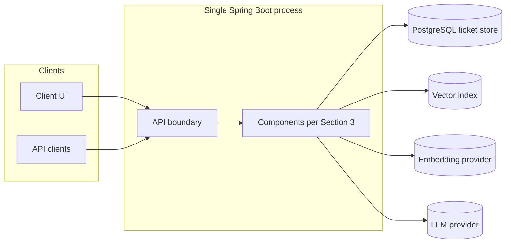
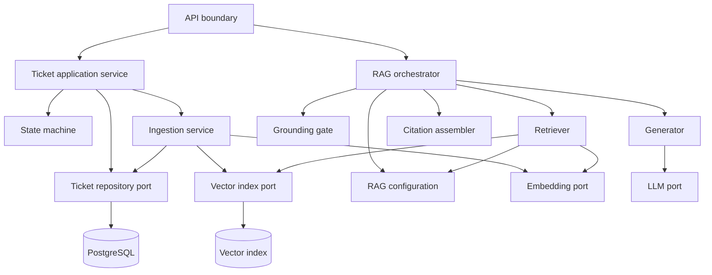
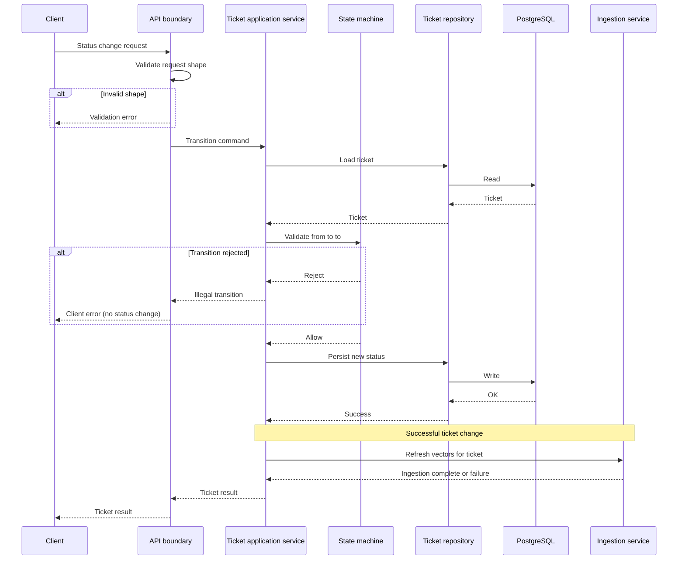
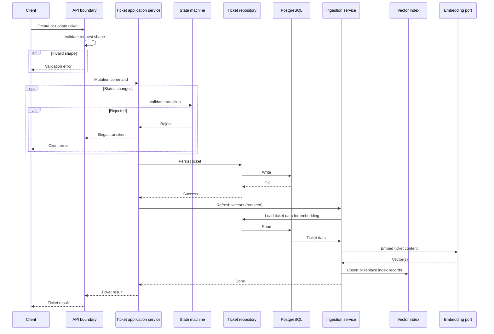
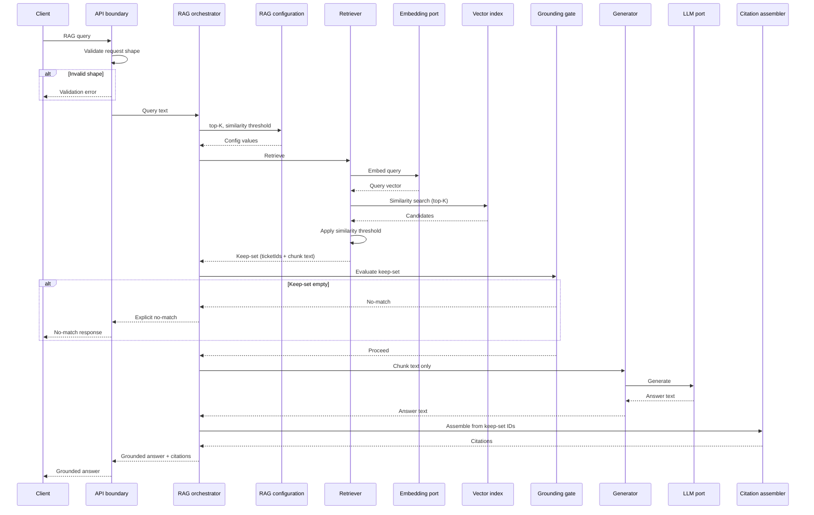

# c2-ticket.ai — Logical Architecture

**Source of truth:** [spec/requirements.md](requirements.md)  
**Document type:** Logical architecture (no implementation, no API paths, no persistence schemas)  
**Deployment shape:** One **Spring Boot** process hosts all components below. **No microservices.**

**Deferred to later specs:** authentication, authorization, tenancy, embedding vendor, vector-store physical layout, LLM vendor.

---

## 1. Purpose and scope

This document describes **logical components**, **trust boundaries**, and **three end-to-end flows** that satisfy the specified requirements:

- Backend-only ticket **state machine** enforcement  
- **Embedding refresh** after successful ticket mutations (server-side consequence, not a client option)  
- **RAG** with configurable `top-K` and similarity threshold, **grounding gate**, and **citations from the keep-set**

It does **not** define HTTP paths, DTO field lists, database tables, or third-party product choices except where the stakeholder brief fixes them (e.g. PostgreSQL as the ticket store).

---

## 2. Context view

| External dependency | Role in architecture | Status |
|---------------------|----------------------|--------|
| PostgreSQL | **Ticket store** — system of record for tickets | **Specified** (this document) |
| Vector index | Stores ticket-linked vectors for similarity search | **Assumption** (requirements ING-1); physical form **open** |
| Embedding provider | Produces vectors for ingestion and query embedding | **Open** (later spec) |
| LLM provider | Generates natural-language answer from keep-set text only | **Open** (later spec) |
| Auth / tenancy | Request identity and data scope | **Open** (later spec) |

---

## 3. Logical components

Components are **in-process modules** (packages or Spring beans), not separate deployables.

### 3.1 Component map

### 3.2 Component responsibilities

| Component | Responsibility | Requirements trace |
|-----------|----------------|---------------------|
| **API boundary** | Validate **request shape** (syntactic/structural). Map outcomes to responses: **ticket result**, **grounded answer**, or **explicit no-match**. Does **not** decide legal status transitions or retrieval relevance. | API-4, API-6, VAL-*; NFR-1 |
| **Ticket application service** | Orchestrate ticket **reads** and **mutations** (including status change). Invoke **state machine** before persisting status changes. On **successful** ticket change, invoke **ingestion** (mandatory). | FR-2–FR-7, FR-13–FR-14, FR-11, API-1–API-3 |
| **State machine** | **Sole authority** for allowed `from → to` status transitions. Rejects same-status, terminal-source, and unlisted transitions. UI hints are not inputs to this decision. | FR-2–FR-7, §5, NFR-1 |
| **Ticket repository port** | Load and persist tickets in **PostgreSQL**. | ASM-7, user brief |
| **Ingestion service** | After successful ticket change, **refresh** vector index entries linked to affected ticket(s). Uses **embedding port**; does not expose a “optional reindex” to clients. | FR-11, ING-2, ING-9 |
| **Vector index port** | Store and query vectors linked to **ticketId** (and chunk identity if chunking is chosen later). | ING-1, RET-1, ING-9 |
| **RAG orchestrator** | Coordinates retrieval → grounding gate → optional generation → citation assembly for a natural-language query. | FR-8–FR-10, API-4 |
| **Retriever** | (1) Embed query via embedding port. (2) Fetch **top-K** from vector index. (3) Apply **similarity threshold** from configuration. (4) Build **keep-set** (ticket IDs + chunk text for survivors). | RET-1–RET-4, FR-12 |
| **RAG configuration** | Supply runtime **top-K** and **similarity threshold** (not hardcoded). | FR-12, NFR-3, API-5 |
| **Grounding gate** | If keep-set is **empty**, stop pipeline and emit **no-match**; **generator is not called**. | FR-9, RET-5, GR-3, NFR-2 |
| **Generator** | Invoke LLM with **only** retrieved **chunk text** from the keep-set (no broader corpus). | GR-1, FR-10 |
| **Citation assembler** | Build citations from **keep-set ticket IDs** (and policy for presentation). **Does not** parse or trust ticket IDs from free-form model text. | FR-10, GR-2 |
| **Embedding port** | Abstraction over embedding vendor (ingestion + query). | **Open** vendor |
| **LLM port** | Abstraction over LLM vendor. | **Open** vendor |

---

## 4. Trust rules and boundaries

These rules are **architectural invariants**; violating them breaks specified requirements.

| # | Rule | Enforced by |
|---|------|-------------|
| T1 | Legal status change is determined **only** by the **state machine**, on every transition request. | State machine ← Ticket application service |
| T2 | Clients (including UI) **cannot** skip ingestion after a successful ticket mutation. | Ticket application service → Ingestion (post-commit) |
| T3 | **Retriever** uses **configuration** for top-K and threshold; order of operations: embed query → top-K fetch → threshold filter → keep-set. | Retriever + RAG configuration |
| T4 | **Empty keep-set** ⇒ **no-match** response; **no** call to generator/LLM. | Grounding gate |
| T5 | Generator input is **only** chunk text from the keep-set. | RAG orchestrator / Generator |
| T6 | **Citations** are derived from the **keep-set**, not from model output parsing. | Citation assembler |
| T7 | API boundary validates **shape** only; business rules live in application and RAG layers. | API boundary vs. TAS / RAG |

**Out of scope for this architecture (later specs):** who may call which capability (auth), and which tickets appear in retrieval (tenancy).

---

## 5. Ticket state machine (logical)

States and edges are **exactly** as specified in requirements §5. The state machine component encodes this graph and exposes a pure decision: `allow(from, to)` or `reject`.

| From | Allowed to |
|------|------------|
| `OPEN` | `IN_PROGRESS`, `CANCELLED` |
| `IN_PROGRESS` | `RESOLVED`, `CANCELLED` |
| `RESOLVED` | `CLOSED` |
| `CLOSED` | *(none — terminal)* |
| `CANCELLED` | *(none — terminal)* |

All other transitions, including **same-status**, are **rejected** at the backend.

---

## 6. Flow: status change

**Trigger:** Client requests a ticket **status transition** (capability API-1).

**Outcome:** Updated **ticket result** in PostgreSQL, or **rejected transition** (no persistence of illegal status).

**Notes (requirements-aligned):**

- Rejection paths must not apply a silent no-op (VAL-1).
- Whether ingestion failure rolls back the ticket transaction is **open** (VAL-6, ING-8); architecture only requires that **successful** change **triggers** ingestion (user brief).
- Concurrent transitions (AQ-6) are **open**; repository behavior not fixed here.

---

## 7. Flow: ticket data change (non-status or combined mutation)

**Trigger:** Client **creates** or **updates** ticket data (capability API-3). Status may change as part of an update only if the same **state machine** path is used.

**Outcome:** Persisted ticket in PostgreSQL; **ingestion** runs as a **consequence** of success—not via a separate client-driven “reindex” call.

**Notes:**

- What constitutes **“ticket data”** for embedding is **open** (ING-3, AQ-2); ingestion reads from the ticket store via the repository port.
- Chunking strategy (single vs. multiple chunks per ticket) is **open** (AQ-2, §3.3); vector records remain linked to **ticketId** per ING-9.
- Ticket **deletion** and vector removal (ING-7) are **open**.

---

## 8. Flow: RAG query

**Trigger:** Client submits a **natural-language query** (capability API-4).

**Outcomes:**

1. **Explicit no-match** — keep-set empty after threshold; **generator not called**.  
2. **Grounded answer** — generator ran on keep-set chunk text only; **citations** from keep-set IDs.

**Retriever ordering (specified behavior):**

1. Embed the query.  
2. Fetch **top-K** candidates (K from configuration).  
3. Apply **similarity threshold**; exclude below threshold.  
4. Produce **keep-set**: surviving **ticketId** entries and **chunk text** payloads.

**Grounding gate:** If no candidates survive step 3, keep-set is **empty** → pipeline stops → **explicit no-match**; steps involving the generator **do not run**.

**Citations:** The citation assembler uses **ticket IDs present in the keep-set**. It does not treat the LLM’s prose as the source of truth for which tickets to cite.

**Open items:**

- No-match **payload** shape and copy (AQ-3).  
- Citation **presentation** (AQ-4).  
- Retrieval scoping by tenant/user (RET-7, FR-16) — hook point at retriever/query, spec TBD.  
- Infrastructure failure during retrieval vs. empty keep-set (VAL-8).

---

## 9. Configuration

| Parameter | Consumer | Requirement |
|-----------|----------|-------------|
| `top-K` | Retriever | FR-12, RET-2, NFR-3 |
| Similarity threshold | Retriever | FR-12, RET-3, NFR-3 |

Configuration is read at runtime by the **Retriever** (via **RAG configuration**). Updating values is capability API-5 in requirements; **how** config is stored (files, DB, admin API) is **open**—only **non-hardcoded** behavior is required.

---

## 10. Persistence and data ownership

| Concern | Owner | Store |
|---------|--------|-------|
| Tickets (including **status**) | Ticket repository port | **PostgreSQL** |
| Ticket-linked vectors | Vector index port | **Logical vector index** (implementation **open**) |

The architecture **does not** define tables, columns, or indexes. Requirements only require:

- Tickets have a **ticketId** and **status** from the enumerated set.  
- Vector records are **linked to ticketId** (and optionally chunk identity later).

---

## 11. Cross-cutting concerns (minimal)

| Concern | Treatment in this document |
|---------|----------------------------|
| **Observability** | Optional hooks at grounding gate (no-match rate), retriever, ingestion, generator (NFR-10 — assumption). Details **open**. |
| **Validation** | Shape at API boundary; transitions at state machine; config sanity **open** beyond requirements (VAL-4). |
| **Errors** | Illegal transition → client error, no persistence. RAG empty keep-set → no-match, not LLM. |

---

## 12. Requirements traceability matrix

| Specified rule (requirements §12.3) | Architectural realization |
|-----------------------------------|---------------------------|
| Status graph + terminal states | State machine component (§5) |
| Backend rejects illegal transitions | TAS always consults SM before persisting status (§6–7) |
| RAG: only retrieved context | Generator ← keep-set chunk text only (§8, T5) |
| Cite ticket IDs from keep-set | Citation assembler (§8, T6) |
| No match ⇒ no LLM | Grounding gate (§8, T4) |
| Embeddings refresh on ticket data change | TAS → Ingestion after successful mutation (§6–7, T2) |
| Configurable top-K and threshold | RAG configuration + Retriever (§8–9, T3) |

---

## 13. Explicitly deferred (later specs)

The following are **not** decided in this logical architecture:

1. **Authentication and authorization** (FR-15, API-7, AQ-7).  
2. **Tenancy / retrieval scope** (FR-16, RET-7, HR-7).  
3. **Embedding vendor and LLM vendor** (ING-5, §3.5).  
4. **Vector index technology** co-located with PostgreSQL vs. separate — only **ports** are defined.  
5. **HTTP paths, payloads, and PostgreSQL schemas.**  
6. **Ingestion failure handling** (retry, compensating actions).  
7. **Exact similarity metric and threshold scale** (AQ-9).

---

## Document control

| Field | Value |
|-------|--------|
| Version | 1.0 |
| Status | Draft — logical layer |
| Depends on | [requirements.md](requirements.md) |
| Next step | API contract spec, persistence spec, auth/tenancy spec (without contradicting §4 trust rules) |