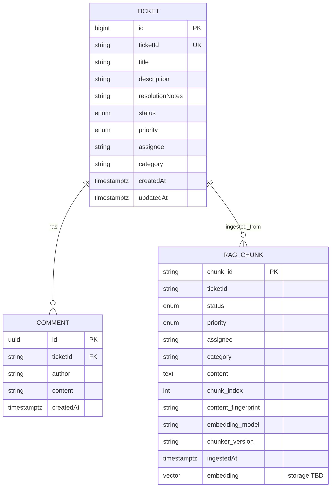

# c2-ticket.ai — Data Model

**Sources:** [requirements.md](requirements.md), [architecture.md](architecture.md), stakeholder decisions in this document  
**Document type:** Logical / physical data design (no JPA, no application code)  
**Ticket store:** PostgreSQL (per architecture)

This spec **locks** ticket and comment shapes, indexing, public `ticketId` rules, and RAG chunk **metadata**. It does **not** define HTTP APIs or entity classes.

---

## 1. Overview

| Aggregate | Storage | Notes |
|-----------|---------|--------|
| **Ticket** | PostgreSQL | System of record |
| **Comment** | PostgreSQL | Child of ticket; mandatory parent |
| **RAG chunk** | Vector index (+ optional PostgreSQL mirror for metadata only) | Refreshed on successful ticket change; metadata **copied from ticket at ingest** |

**Ingestion scope for embeddable text:** Requirements left “ticket data” open (ING-3). This spec defines **ticket scalar fields** and **comments** as the domain content worth modeling; whether **comments** are concatenated into chunks is an implementation choice in the chunker, not repeated as separate comment rows in RAG metadata unless a later spec says so. Chunk **content** is the embedded text for one chunk; metadata fields are the locked snapshot below.

---

## 2. Ticket

### 2.1 Fields (locked)

| Field | Type (logical) | Nullable | Constraints | Notes |
|-------|----------------|----------|-------------|--------|
| `id` | 64-bit integer surrogate | No | Primary key | Internal only; never cited in RAG answers |
| `ticketId` | String | No | Unique; must match `^TKT-[0-9]+$` | **Public business key**; used in citations (requirements) |
| `title` | String | No | Max length **255** | Required on create |
| `description` | String | Yes | Max length **10 000** | Optional |
| `resolutionNotes` | String | Yes | Max length **10 000** | Optional |
| `status` | Enum | No | See §2.2 | Default **OPEN** on create |
| `priority` | Enum | No | See §2.3 | Default **MEDIUM** when omitted on create |
| `assignee` | String | Yes | — | Identifier or display name; format not fixed here |
| `category` | String | Yes | — | Free-text or taxonomy label; format not fixed here |
| `createdAt` | Timestamp with time zone | No | Set on create | |
| `updatedAt` | Timestamp with time zone | No | Set on create/update | |

### 2.2 Status enum (locked)

| Value | Terminal | Notes |
|-------|----------|--------|
| `OPEN` | No | **Initial status** for new tickets |
| `IN_PROGRESS` | No | |
| `RESOLVED` | No | |
| `CLOSED` | Yes | |
| `CANCELLED` | Yes | |

Transitions are **not** stored in this document; enforcement remains the state machine in [architecture.md](architecture.md).

### 2.3 Priority enum (locked)

| Value |
|-------|
| `LOW` |
| `MEDIUM` |
| `HIGH` |

**Default:** `MEDIUM` when priority is omitted on create.

### 2.4 Public identifier `ticketId` (locked)

| Rule | Detail |
|------|--------|
| **Issuer** | Backend only; clients **never** send `ticketId` on create |
| **Pattern** | `TKT-{n}` where `n` is a positive integer, e.g. `TKT-1001`, `TKT-1002`, … |
| **Validation regex** | `^TKT-[0-9]+$` |
| **Uniqueness** | Globally unique business key (unique index) |
| **Allocation** | Monotonic sequence of numeric suffixes; **first issued value in the sequence is `1001`** unless a later migration spec states otherwise |

**Sequence strategy (logical):** A dedicated numeric sequence (or single-row counter table) advances the suffix; the application formats `TKT-` + suffix. Concurrent creates must not duplicate suffixes (transactional allocation).

**Surrogate `id` vs `ticketId`:** APIs and RAG citations use **`ticketId`**. Joins and FKs may use either `id` or `ticketId`; comments use **`ticketId`** as specified below.

---

## 3. Comment

### 3.1 Fields (locked)

| Field | Type (logical) | Nullable | Constraints | Notes |
|-------|----------------|----------|-------------|--------|
| `id` | UUID | No | Primary key | Server-generated |
| `ticketId` | String | No | FK → `ticket.ticketId` | Must reference an existing ticket |
| `author` | String | Yes | — | Author identity; auth model **open** |
| `content` | String | No | — | Max length **not specified** in this prompt |
| `createdAt` | Timestamp with time zone | No | Set on create | |

### 3.2 Relationship (locked)

| Rule | Detail |
|------|--------|
| Cardinality | **Many comments** belong to **one ticket** |
| Existence | A comment **cannot exist** without its ticket |
| Referential integrity | Delete ticket → comment orphans **disallowed**; behavior on ticket delete is **open** (see §7) |

**Foreign key:** `comment.ticketId` → `ticket.ticketId` (reference the business key so citations and comments share the same identifier).

---

## 4. Indexes — PostgreSQL (locked)

Indexes apply to the **ticket** table unless a later spec adds comment indexes.

| Index | Columns | Type | Purpose |
|-------|---------|------|---------|
| `uk_ticket_ticket_id` | `ticketId` | **Unique** | Business key lookup; FK target for comments |
| `ix_ticket_status` | `status` | Non-unique | Filter by status |
| `ix_ticket_priority` | `priority` | Non-unique | Filter by priority |
| `ix_ticket_assignee` | `assignee` | Non-unique | Filter by assignee |
| `ix_ticket_category` | `category` | Non-unique | Filter by category |
| `ix_ticket_status_created_at` | `status`, `createdAt` | Non-unique | Filter/sort by status and recency (e.g. OPEN by newest) |

**Comment table:** No indexes mandated in this spec; a non-unique index on `comment.ticketId` is a practical follow-on for load-by-ticket (implementation detail, not locked).

---

## 5. RAG chunk — metadata (locked)

Each **chunk** is one embeddable unit in the vector index. On **ingest**, metadata below is **copied from the ticket** (and from chunking of ticket-derived text into `content`). It is a **snapshot** at ingest time; it does not auto-update until the next successful ingestion refresh for that ticket.

### 5.1 Metadata fields (locked)

| Field | Type (logical) | Source at ingest | Notes |
|-------|----------------|------------------|--------|
| `ticketId` | String | Ticket | Citation / filtering key |
| `status` | Status enum | Ticket | Snapshot |
| `priority` | Priority enum | Ticket | Snapshot |
| `assignee` | String | Ticket | Snapshot |
| `category` | String | Ticket | Snapshot |
| `content` | Text | Chunker output | Text that was (or will be) embedded |
| `chunk_index` | Integer | Chunker | 0-based or 1-based order within ticket; **chunker defines convention** |
| `content_fingerprint` | String | Derived | Hash/checksum of `content` for idempotent refresh |
| `embedding_model` | String | Configuration | Model id used for this vector |
| `chunker_version` | String | Configuration | Version of chunking logic |
| `ingestedAt` | Timestamp with time zone | Ingestion clock | When this chunk record was written |

### 5.2 Vector payload (not locked)

| Field | Notes |
|-------|--------|
| `embedding` | Fixed-dimension vector from embedding provider; dimension and storage type **deferred** (pgvector column vs external index) |

### 5.3 Chunk identity (logical)

| Rule | Detail |
|------|--------|
| Uniqueness | One chunk record is unique per (`ticketId`, `chunk_index`, `chunker_version`) **or** per stable `chunk_id` derived from those; exact key formula is implementation detail |
| Refresh | On ticket change, ingestion **replaces or supersedes** chunks for that `ticketId` (requirements ING-2) |

### 5.4 Retrieval projection → keep-set

Retriever returns survivors with at least **`ticketId`** and **chunk `content`** for the generator (architecture). Citations use **`ticketId`** from the keep-set (requirements FR-10).

---

## 6. Configuration data (reference)

Not part of ticket/comment/RAG row shapes; stored per [requirements.md](requirements.md) FR-12:

| Parameter | Used by |
|-----------|---------|
| `top-K` | Retriever |
| Similarity threshold | Retriever |

Persistence mechanism for configuration is **not** part of this data model.

---

## 7. Still open (explicit)

The following remain **undeclared** until a later spec. This document does not block implementation of locked entities above.

| Topic | Why open |
|-------|----------|
| **Auth** | Who may create/read/update tickets, comments, or RAG queries; meaning of `assignee` and `author` as security principals |
| **Pagination** | List tickets/comments: cursor vs offset, default page size, sort fields beyond `status + createdAt` index |
| **Delete** | Hard vs soft delete for tickets and comments; cascade vs restrict; effect on RAG chunks (purge vs orphan) |
| **CLOSED / CANCELLED in corpus** | Whether terminal tickets remain in the vector index for retrieval or are excluded at ingest/query time |
| **Comment `content` max length** | Not set in stakeholder brief |
| **Tenancy** | No tenant key on ticket (requirements FR-16) |
| **RAG: comments in chunk text** | Whether ingestion embeds comments with description or ticket fields only |
| **Assignee / category formats** | Validation rules, enums vs free text |
| **Vector store layout** | Co-located with PostgreSQL vs separate; column types |

---

## 8. Consistency with requirements and architecture

| Requirement | Data model support |
|-------------|-------------------|
| Status machine states | Ticket `status` enum matches §5 in requirements |
| RAG cites `ticketId` | Business key on ticket and chunk metadata |
| Embedding refresh on ticket change | Chunk rows tied to `ticketId`; metadata re-copied on ingest |
| PostgreSQL ticket store | Ticket + Comment in PostgreSQL |
| Ingestion after successful mutation | Ticket `updatedAt` / content changes drive re-ingest; chunk `ingestedAt` records refresh |

---

## 9. Validation summary (persistence layer)

| Entity | Rule |
|--------|------|
| Ticket | `title` required, len ≤ 255; `description` / `resolutionNotes` len ≤ 10 000; `status` ∈ enum; `priority` ∈ enum; `ticketId` matches regex; unique `ticketId` |
| Ticket create | `status` = `OPEN`; `priority` = `MEDIUM` if omitted |
| Comment | `ticketId` must exist; `content` required |
| RAG chunk | Metadata fields present at ingest; `ticketId` references a ticket that existed at ingest time |

---

## Document control

| Field | Value |
|-------|--------|
| Version | 1.0 |
| Status | Locked fields per stakeholder prompt |
| Next step | API contract, auth, delete/corpus policy, vector storage DDL |