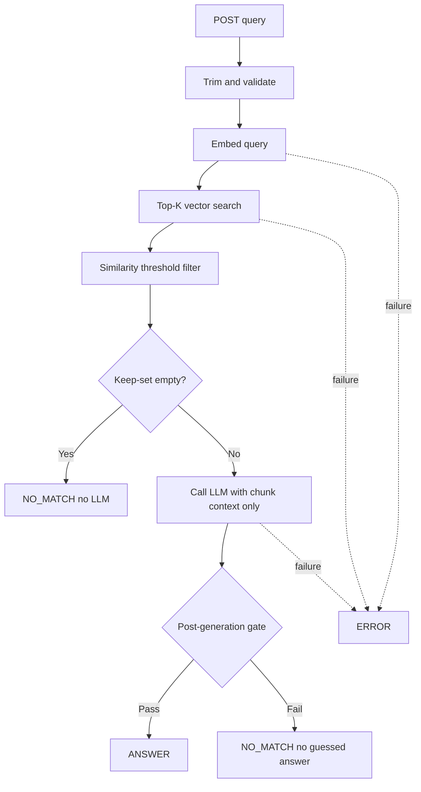

# c2-ticket.ai — RAG Query API Contract

**Sources:** [requirements.md](requirements.md), [architecture.md](architecture.md), [data-model.md](data-model.md), [rag-ingestion.md](rag-ingestion.md)  
**Document type:** Stable JSON contract for the frontend (no implementation code)  
**Version:** 1.0 — breaking changes require a new API version path.

This spec defines **one endpoint** and a **fixed response envelope**. The frontend may rely on every top-level key being present on successful envelope responses.

---

## 1. Endpoint

| Item | Value |
|------|--------|
| Method | `POST` |
| Path | **`/api/v1/rag/query`** |
| Content-Type | `application/json` |

---

## 2. Request

### 2.1 Body schema

| Field | Type | Required | Rules |
|-------|------|----------|--------|
| `query` | string | **Yes** | Trim leading/trailing whitespace before validation |

**Example:**

```json
{
  "query": "How was TKT-1002 resolved?"
}
```

### 2.2 Validation

| Condition | HTTP | Behavior |
|-----------|------|----------|
| Missing `query` | **400** | Reject (request shape validation at API boundary) |
| `query` null or not a string | **400** | Reject |
| After trim, `query` is empty (`""`) | **400** | Reject |
| Extra JSON properties | **400** or ignore | **Open** — recommend **reject** for strict contract stability |

**Note:** Request validation failures occur **before** the RAG pipeline. They **do not** use the response envelope in §3 unless a later implementation standardizes Problem Details; this spec does **not** mandate envelope shape for **400** validation errors.

---

## 3. Response envelope (normative)

### 3.1 Stability rule

**Every key below is always present** on responses that use this envelope. Keys with no applicable value are **`null`** (or empty array where specified).

### 3.2 Schema

```json
{
  "outcome": "ANSWER" | "NO_MATCH" | "ERROR",
  "query": "<string>",
  "answer": { "text": "<string>" } | null,
  "citations": [ { "ticketId": "TKT-…", "title": "…" } ],
  "confidence": { "score": <number>, "basis": "RETRIEVAL" } | null,
  "escalation": { "recommended": <boolean>, "reason": "<string>" | null } | null,
  "error": { "code": "<string>", "message": "<string>" } | null,
  "noMatch": { "code": "<string>", "message": "<string>" } | null
}
```

| Field | When non-null |
|-------|----------------|
| `outcome` | Always set |
| `query` | Echo of **trimmed** request `query` |
| `answer` | **`ANSWER`** only |
| `citations` | Always an **array** (possibly empty) |
| `confidence` | **`ANSWER`** only |
| `escalation` | Always an object for **`ANSWER`**, **`NO_MATCH`**; **`null`** for **`ERROR`** |
| `error` | **`ERROR`** only |
| `noMatch` | **`NO_MATCH`** only |

### 3.3 `citations` item

| Field | Type | Rules |
|-------|------|--------|
| `ticketId` | string | Business key; pattern `^TKT-[0-9]+$` per [data-model.md](data-model.md) |
| `title` | string | Loaded from **ticket store** at response build time (not from model output) |

---

## 4. Pipeline overview

Aligns with [architecture.md](architecture.md) and [rag-ingestion.md](rag-ingestion.md) §10.



| Stage | Failure type |
|-------|----------------|
| Empty keep-set after threshold | **`NO_MATCH`** (not `ERROR`) |
| Embedding / vector store / generation | **`ERROR`** |
| Post-generation gate | **`NO_MATCH`** (downgrade) |

---

## 5. Outcome: `NO_MATCH`

### 5.1 Empty keep-set (retrieval gate)

**Condition:** After query embedding, **top-K** fetch, and **similarity-threshold** filter, the keep-set has **no** chunks (no ticket qualifies).

| Rule | Value |
|------|--------|
| HTTP status | **200 OK** |
| Call LLM | **No** |
| `outcome` | **`NO_MATCH`** |
| `answer` | **`null`** |
| `citations` | **`[]`** |
| `confidence` | **`null`** |
| `escalation` | `{ "recommended": true, "reason": "<string>" \| null }` |
| `error` | **`null`** |
| `noMatch.code` | **`NO_RELEVANT_TICKETS`** |
| `noMatch.message` | Human-readable; stable copy recommended: e.g. `"No tickets matched your question."` |

`escalation.reason` may be **`null`** or a short hint (e.g. suggest rephrasing or human support); not locked beyond **recommended: true**.

### 5.2 Post-generation gate failure (downgrade)

**Condition:** LLM was called, but a **post-generation gate** rejects the draft answer:

| Gate check | Description |
|------------|-------------|
| **Ticket ID** | Any ticket id pattern in `answer.text` that is **not** in the keep-set’s `ticketId` set |
| **Duration claim** | A duration claim in the answer **contradicts** the supplied ticket context (detection rules in implementation; contract requires downgrade, not `ANSWER`) |

| Rule | Value |
|------|--------|
| HTTP status | **200 OK** |
| `outcome` | **`NO_MATCH`** |
| `answer` | **`null`** — **do not** return the rejected draft as `ANSWER` |
| `citations` | **`[]`** |
| `confidence` | **`null`** |
| `escalation` | `{ "recommended": true, "reason": "<string>" \| null }` |
| `error` | **`null`** |
| `noMatch.code` | **`GROUNDING_GATE_FAILED`** |
| `noMatch.message` | Human-readable; e.g. `"Answer could not be verified against retrieved tickets."` |

**Rationale:** Requirements forbid guessing; a failed gate is treated like “no safe answer,” not infrastructure failure.

---

## 6. Outcome: `ANSWER`

**Condition:** Non-empty keep-set, LLM succeeded, post-generation gate **passed**.

| Field | Value |
|-------|--------|
| HTTP status | **200 OK** |
| `outcome` | **`ANSWER`** |
| `answer.text` | Model-generated text (grounded prompt §8.1) |
| `citations` | See §6.1 |
| `confidence` | See §6.2 |
| `escalation` | `{ "recommended": false, "reason": null }` |
| `error` | **`null`** |
| `noMatch` | **`null`** |

### 6.1 Citations (keep-set only)

| Rule | Detail |
|------|--------|
| Source | **Only** `ticketId` values present in the keep-set after retrieval |
| Cardinality | **One citation per distinct `ticketId`** in the keep-set (not one per chunk) |
| Order | **Descending** best similarity score for that ticket among keep-set chunks, then **ascending `ticketId`** (lexicographic) |
| `title` | Loaded from **PostgreSQL ticket store** by `ticketId` |
| Model prose | **Not** used to select or invent citations |

**Best similarity per ticket:** Among keep-set rows for a given `ticketId`, use the maximum **s** (where **s = 1 − distance** per [rag-ingestion.md](rag-ingestion.md)).

### 6.2 Confidence

| Field | Value |
|-------|--------|
| `confidence.score` | **Best keep-set similarity** = max **s** over all chunks in the keep-set (global best match) |
| `confidence.basis` | **`RETRIEVAL`** (literal enum; only defined value in v1) |

---

## 7. Outcome: `ERROR`

**Condition:** Infrastructure failure in **query embedding**, **vector store** access/search, or **text generation** (LLM call). Empty keep-set and grounding gate failures are **not** `ERROR`.

| Field | Value |
|-------|--------|
| HTTP status | **503 Service Unavailable** (or **502** if upstream LLM; use **503** for uniform client handling unless load balancer requires 502 — implementation may map by `error.code`) |
| `outcome` | **`ERROR`** |
| `answer` | **`null`** |
| `citations` | **`[]`** |
| `confidence` | **`null`** |
| `escalation` | **`null`** |
| `error` | `{ "code", "message" }` — see §7.1 |
| `noMatch` | **`null`** |

### 7.1 Stable `error.code` values (v1)

| Code | When |
|------|------|
| `EMBEDDING_FAILED` | Query embedding call failed or invalid response |
| `VECTOR_STORE_FAILED` | PGVector / DB search failed |
| `GENERATION_FAILED` | LLM call failed, timeout, or empty invalid response |

`message` is human-readable and may include correlation id in logs only (not required in JSON).

---

## 8. Generator instructions (normative)

The following text is **normative**. It must be copied **verbatim** into the LLM system or developer instructions for RAG generation (placeholder for chunk context is appended by the implementation).

### 8.1 Grounding instructions (verbatim)

Answer the user's question using only the supplied ticket context.
Do not use general knowledge to answer support-specific questions.
If the supplied context does not contain enough information to answer the question, explicitly state that no relevant tickets were found.
Do not invent ticket IDs, events, causes, resolutions, users, or dates.
Every factual claim about a ticket must be supported by the retrieved ticket context.

### 8.2 Context payload

| Rule | Detail |
|------|--------|
| Content | **Only** chunk `content` strings from the keep-set |
| Ordering | Chunk order **open**; must include full keep-set |
| Citations in response | Assembled by backend (§6.1), not parsed from model text for the **citations** array |

---

## 9. HTTP status summary

| Situation | HTTP |
|-----------|------|
| Invalid / blank `query` | **400** |
| `ANSWER` | **200** |
| `NO_MATCH` (empty keep-set or gate) | **200** |
| `ERROR` (infrastructure) | **503** (recommended) |

---

## 10. Examples

### 10.1 `NO_MATCH` — empty keep-set

```json
{
  "outcome": "NO_MATCH",
  "query": "refund policy for Mars colony",
  "answer": null,
  "citations": [],
  "confidence": null,
  "escalation": {
    "recommended": true,
    "reason": null
  },
  "error": null,
  "noMatch": {
    "code": "NO_RELEVANT_TICKETS",
    "message": "No tickets matched your question."
  }
}
```

### 10.2 `ANSWER`

```json
{
  "outcome": "ANSWER",
  "query": "What happened on TKT-1001?",
  "answer": {
    "text": "TKT-1001 was closed after …"
  },
  "citations": [
    { "ticketId": "TKT-1001", "title": "Login failure" },
    { "ticketId": "TKT-1005", "title": "Auth timeout" }
  ],
  "confidence": {
    "score": 0.86,
    "basis": "RETRIEVAL"
  },
  "escalation": {
    "recommended": false,
    "reason": null
  },
  "error": null,
  "noMatch": null
}
```

### 10.3 `ERROR`

```json
{
  "outcome": "ERROR",
  "query": "status of billing tickets",
  "answer": null,
  "citations": [],
  "confidence": null,
  "escalation": null,
  "error": {
    "code": "GENERATION_FAILED",
    "message": "Unable to generate an answer at this time."
  },
  "noMatch": null
}
```

---

## 11. Requirements traceability

| Requirement | Contract |
|-------------|----------|
| FR-9 — no-match, no LLM | §5.1 |
| FR-10 — cite ticket IDs from keep-set | §6.1 |
| GR-1 — only retrieved context | §8 |
| Architecture T4 — grounding gate | §5.1 |
| Architecture T6 — citations not from model parsing | §6.1, §8.2 |
| rag.retrieval top-K then threshold | §4 |

---

## 12. Open (not in this contract)

| Topic | Notes |
|-------|--------|
| Auth on `POST /api/v1/rag/query` | Deferred |
| Rate limits | Deferred |
| Duration-claim detection algorithm | Implementation; outcome fixed in §5.2 |
| Ticket ID regex in answer text | Must match `TKT-[0-9]+` style ids not in keep-set |
| Streaming / partial answers | Not supported in v1 |

---

## Document control

| Field | Value |
|-------|--------|
| Version | 1.0 |
| Status | Locked for frontend integration |
| Next step | Mock server fixtures, contract tests, LLM integration spec |