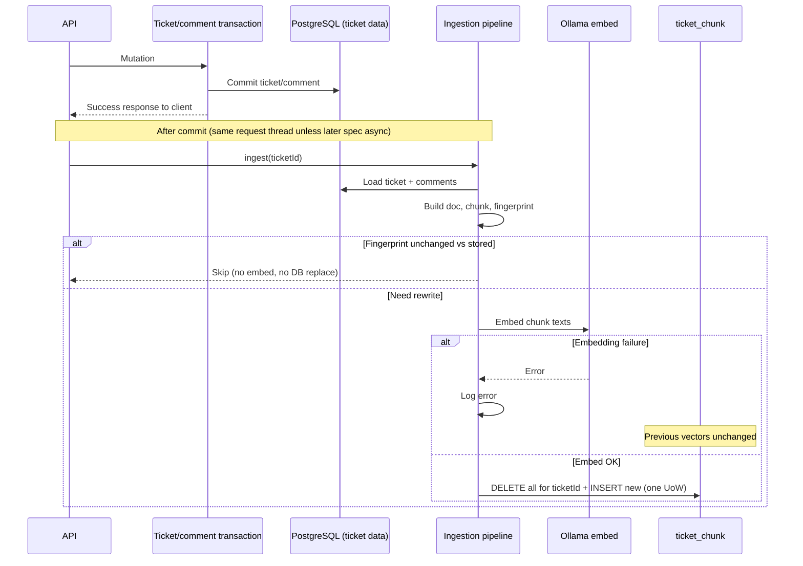

# c2-ticket.ai — RAG Ingestion Specification

**Sources:** [requirements.md](requirements.md), [architecture.md](architecture.md), [data-model.md](data-model.md), [state-machine.md](state-machine.md)  
**Document type:** Ingestion, chunking, embedding, and vector persistence (no Java)  
**Scope:** Server-side pipeline from committed ticket/comment mutations to `ticket_chunk` rows in PostgreSQL (PGVector). Retrieval configuration bound here because it shares the RAG configuration surface (decision 10).

---

## 1. Locked decisions summary

| ID | Decision |
|----|----------|
| ING-D-1 | **Internal pipeline only.** Clients cannot trigger or substitute sync. |
| ING-D-2 | **Post-commit, synchronous** ingest after ticket/comment TX commits. Failed ingest **does not** roll back ticket data. On **embedding failure**, **log** and **keep existing vectors**. |
| ING-D-3 | **Knowledge document** built from a fixed template; **omit blank sections**. |
| ING-D-4 | **Section-based chunking** with fixed-size overflow (**section-v1**); character limits, not token limits, drive splitting. |
| ING-D-5 | **Fingerprint** = hash of content + metadata + chunker version + embedding model; **skip** full rewrite when unchanged. |
| ING-D-6 | **Dev embeddings:** Ollama `nomic-embed-text`, dim **768**, `http://localhost:11434`; same model for ingest and query. Cloud embeddings optional for production only. |
| ING-D-7 | **Vector store:** PGVector in **same** PostgreSQL DB; table **`ticket_chunk`**; `vector(768)`; cosine distance `<=>`; similarity **s = 1 − distance**; **HNSW** with **`vector_cosine_ops`**. |
| ING-D-8 | **Replace semantics:** delete all rows for `ticketId`, then insert new set, **one unit of work**—but only after successful embedding (§8). **No usable content** ⇒ delete existing vectors for that ticket. |
| ING-D-9 | **Re-ingest triggers:** create ticket, field update, comment add, status change. |
| ING-D-10 | **Retrieval config:** `rag.retrieval.*` via `@ConfigurationProperties`; **RagRetrievalService** constructor-injected; **no** hardcoded `5` or `0.72`; order **top-K then threshold**. |

---

## 2. Triggers and placement in the application

### 2.1 ING-D-1 — Not client-driven

| Rule | Detail |
|------|--------|
| No public “reindex” or “sync embeddings” API for clients | Ingestion is invoked only from the monolith after successful writes |
| Ticket application / comment services | Call ingestion hook after **commit** |

### 2.2 ING-D-9 — When to run

| Event | Re-ingest `ticketId` |
|-------|----------------------|
| Ticket **create** | Yes |
| Ticket **field update** (any mutable field except status via general PATCH) | Yes |
| **Comment add** on ticket | Yes (parent `ticketId`) |
| **Status change** (dedicated status PATCH, after allowed transition) | Yes |

Each invocation is **full re-ingest** for that `ticketId` (rebuild document → chunk → fingerprint check → embed → replace).

### 2.3 ING-D-2 — Timing and failure isolation



| Rule | Detail |
|------|--------|
| Commit order | Ticket/comment data is **visible** before ingest starts |
| Rollback | Ingest failure **must not** undo ticket/comment transaction |
| Embedding failure | **Log** (level ERROR or WARN per ops policy); **do not** DELETE/UPDATE `ticket_chunk` for that attempt |
| Client response | Success of HTTP mutation does **not** wait on embed success unless product later requires 202/async (not locked here) |

**Note:** Architecture previously left ingest failure vs rollback as open; **ING-D-2** locks **no rollback** and **preserve vectors on embed failure**.

---

## 3. Knowledge document (ING-D-3)

Built in memory from PostgreSQL ticket row and comments for `ticketId`, **read-only** at ingest time.

### 3.1 Section template

Sections appear **in this order**. **Omit** a section entirely if it would be blank (null, empty, or whitespace-only).

| Order | Section label (logical) | Source |
|-------|-------------------------|--------|
| 1 | **Title** | `ticket.title` |
| 2 | **Description** | `ticket.description` |
| 3 | **Comments** | All comments for `ticketId`, **chronological** by `createdAt` ascending |
| 4 | **Resolution notes** | `ticket.resolutionNotes` |

### 3.2 Comments formatting

| Rule | Detail |
|------|--------|
| One line per comment | Single text line per comment (newlines in `content` normalized to space or stripped per implementation; result must be one logical line) |
| Order | `createdAt` ascending |
| Line content | Include enough to identify utterance, e.g. `{author}: {content}` when `author` present; otherwise `content` only (exact prefix not locked) |

### 3.3 Metadata snapshot (not in document body)

Copied onto **each** `ticket_chunk` row at ingest per [data-model.md](data-model.md) §5.1:

`ticketId`, `status`, `priority`, `assignee`, `category`

These values participate in **fingerprinting** (§7) and retrieval filtering (future specs).

---

## 4. Chunking — section-v1 (ING-D-4, ING-D-5 overflow)

**Chunker version (locked):** `section-v1`

### 4.1 Configuration

| Property | Default | Used by chunker |
|----------|---------|----------------|
| `rag.chunk.max-characters` | `2000` | **Yes** — max chunk body size after prefix |
| `rag.chunk.overlap-characters` | `250` | **Yes** — sliding split within oversized section |
| `rag.chunk.max-tokens` | (optional) | **No** — may exist in config; chunker **ignores** |
| `rag.chunk.overlap-tokens` | (optional) | **No** — chunker **ignores** |

Chunker operates on **Unicode code units / Java `char` length** consistently in one implementation (document which in code review; spec locks **characters**, not tokens).

### 4.2 Section model for chunking

| Section key | Text fed to chunker |
|-------------|---------------------|
| `title+description` | Concatenation of non-blank Title and Description sections with a separator (e.g. blank line) |
| `comment[i]` | Each comment line from §3.2 |
| `resolution` | Resolution notes section |

**Processing order:** `title+description` → each comment in order → `resolution`.

### 4.3 Global single-chunk shortcut

If the **entire knowledge document** (all non-omitted sections joined with sensible separators) has length **≤ `rag.chunk.max-characters`**:

- Emit **exactly one chunk** containing that full document (before prefix).
- **Do not** split by section.

### 4.4 Section-based path (document too large)

When the whole document exceeds `rag.chunk.max-characters`:

1. Process each **section** independently in order above.
2. If section length **≤ `rag.chunk.max-characters`**, emit **one chunk** for that section.
3. If section length **>** `rag.chunk.max-characters`**, split with **fixed-size windows**: window = `max-characters`, advance by `max-characters − overlap-characters`, until section consumed (**ING-D-5 overflow**).

### 4.5 Chunk text prefix (every chunk)

Every stored chunk’s embeddable **content** starts with:

```text
[Ticket {ticketId}] {title}
```

followed by `\n` and the section (or window) body. `{title}` is current ticket title; `{ticketId}` is business key.

### 4.6 `chunk_index`

| Rule | Detail |
|------|--------|
| Assignment | `0 .. n−1` in **emission order** across all chunks for the ticket |
| Stability | Indices are **not** stable across re-ingests if chunk count changes |

---

## 5. Embeddings (ING-D-6)

### 5.1 Development (locked path)

| Setting | Value |
|---------|--------|
| Runtime | **Ollama** local |
| Base URL | `http://localhost:11434` |
| Model | **`nomic-embed-text`** |
| Dimension | **768** |
| Usage | **Identical** model and endpoint for **ingest** and **query** embedding |

### 5.2 Production (optional, not dev)

| Rule | Detail |
|------|--------|
| Cloud / other providers | Allowed as **optional** production alternative |
| Not the dev default | Local Ollama path remains the reference for development and CI fixtures |

### 5.3 Failure behavior (ING-D-2)

| Outcome | Action |
|---------|--------|
| HTTP error, timeout, wrong dimension | Log structured error with `ticketId`; **abort** replace; **retain** existing `ticket_chunk` rows |
| Partial embed in multi-chunk ticket | **Do not** apply replace; retain previous set (all-or-nothing embed before replace) |

---

## 6. Vector store — `ticket_chunk` (ING-D-7, ING-D-8)

### 6.1 Storage

| Item | Value |
|------|--------|
| Extension | **pgvector** |
| Database | **Same** PostgreSQL instance as tickets/comments |
| Table | **`ticket_chunk`** |

### 6.2 Column model (logical)

Aligns with [data-model.md](data-model.md) §5; ingestion locks storage detail:

| Column | Type | Notes |
|--------|------|--------|
| `id` | Bigint or UUID | Surrogate PK |
| `ticket_id` | Text | Business key; matches `ticket.ticketId` |
| `chunk_index` | Integer | §4.6 |
| `content` | Text | Full chunk including prefix |
| `status` | Ticket status enum | Snapshot |
| `priority` | Ticket priority enum | Snapshot |
| `assignee` | Text | Snapshot |
| `category` | Text | Snapshot |
| `content_fingerprint` | Text | §7 |
| `embedding_model` | Text | e.g. `nomic-embed-text` |
| `chunker_version` | Text | `section-v1` |
| `ingested_at` | Timestamptz | Set at successful replace |
| `embedding` | `vector(768)` | PGVector |

### 6.3 Similarity semantics (retrieval alignment)

| Item | Rule |
|------|------|
| Distance operator | Cosine distance **`<=>`** |
| Similarity score | **s = 1 − distance** |
| Threshold compare | Keep candidates where **s ≥ `rag.retrieval.similarity-threshold`** (after top-K step; §10) |

### 6.4 Index

| Object | Definition |
|--------|------------|
| HNSW on `embedding` | `USING hnsw (embedding vector_cosine_ops)` |

Additional B-tree on `(ticket_id)` for delete-by-ticket and admin queries.

### 6.5 ING-D-8 — Replace semantics

| Step | Rule |
|------|------|
| Precondition | All chunk texts for ticket successfully embedded (or fingerprint skip — §7) |
| Unit of work | **Single transaction:** `DELETE FROM ticket_chunk WHERE ticket_id = ?` then **INSERT** full new row set |
| No usable content | Document empty after template (all sections omitted) → **delete all** rows for `ticketId`, **insert zero** (corpus removal for that ticket) |
| Embed failure | **Do not** open replace transaction |

---

## 7. Fingerprinting and skip (ING-D-5)

### 7.1 Per-chunk fingerprint input

Canonical serialized form (stable field order, normalized whitespace policy) over:

| Input | Source |
|-------|--------|
| **Content** | Final chunk text **including** `[Ticket …]` prefix |
| **Metadata** | `ticketId`, `status`, `priority`, `assignee`, `category` |
| **Chunker version** | `section-v1` |
| **Embedding model** | Configured model id (e.g. `nomic-embed-text`) |

**Algorithm:** Cryptographic hash (e.g. SHA-256) hex string stored in `content_fingerprint`.

### 7.2 Skip rewrite

| Rule | Detail |
|------|--------|
| When | After chunking, compare **ordered** list of `(chunk_index, content_fingerprint)` to existing `ticket_chunk` rows for `ticketId` |
| Match | Same count and every fingerprint equal → **skip** embed and **skip** delete/insert |
| Mismatch | Any difference → full embed + replace (§6.5) |

Fingerprint change on **status-only** update ensures re-embed when metadata snapshot changes even if body text identical.

---

## 8. Ingestion pipeline (ordered steps)

| Step | Action |
|------|--------|
| 1 | Load ticket by `ticketId`; load comments chronological |
| 2 | Build knowledge document (§3) |
| 3 | Chunk with **section-v1** (§4) |
| 4 | Compute fingerprints (§7) |
| 5 | If unchanged vs DB → **stop** |
| 6 | If no chunks → **delete all** for `ticketId` in one TX → **stop** |
| 7 | Call Ollama embed for **each** chunk text (batch if API supports) |
| 8 | On success → **delete all + insert all** (§6.5) with metadata and `ingested_at` |
| 9 | On embed failure → log, **stop** (vectors unchanged) |

---

## 9. Configuration properties (ingestion-related)

Spring **`@ConfigurationProperties`** (prefixes locked for this spec):

### 9.1 `rag.chunk`

| Key | Default |
|-----|---------|
| `max-characters` | `2000` |
| `overlap-characters` | `250` |
| `max-tokens` | (unset) — not used by chunker |
| `overlap-tokens` | (unset) — not used by chunker |

### 9.2 `rag.embedding` (dev defaults)

| Key | Default |
|-----|---------|
| `provider` | `ollama` (dev) |
| `base-url` | `http://localhost:11434` |
| `model` | `nomic-embed-text` |
| `dimension` | `768` |

### 9.3 `rag.ingestion`

| Key | Purpose |
|-----|---------|
| `chunker-version` | `section-v1` (constant unless chunker upgraded) |

---

## 10. Retrieval configuration (ING-D-10)

Not part of ingest logic, but **locked** with this RAG spec for a single configuration story.

| Property prefix | Class | Injection |
|-----------------|-------|-----------|
| **`rag.retrieval`** | `@ConfigurationProperties` record/class | Constructor injection into **`RagRetrievalService`** |

| Key | Default | Rule |
|-----|---------|------|
| `top-k` | **`5`** | Must not be hardcoded as literal `5` in `RagRetrievalService` |
| `similarity-threshold` | **`0.72`** | Must not be hardcoded as literal `0.72` in `RagRetrievalService` |

### 10.1 Retrieval order (requirements + architecture)

**RagRetrievalService** (query path):

1. Embed query (same **ING-D-6** model in dev).
2. Vector search: ORDER BY distance, LIMIT **`top-k`**.
3. Filter: keep rows where **s = 1 − distance ≥ similarity-threshold**.
4. Result → **keep-set** for grounding gate / generator.

Ingestion does **not** apply threshold at write time.

---

## 11. Requirements traceability

| Requirement | This spec |
|-------------|-----------|
| FR-11 / ING-2 — refresh on ticket data change | §2, §8 |
| FR-12 / RET-2–3 — configurable K and threshold | §10 |
| ING-9 — ticketId on chunk | §6.2 |
| Architecture T2 — post-mutation ingest | §2 |
| Architecture T3 — top-K then threshold | §10.1 |
| Data model §5 — chunk metadata | §6.2, §3.3 |

---

## 12. Still open (not locked by this spec)

| Topic | Notes |
|-------|--------|
| **Auth** | Who can trigger mutations that indirectly re-ingest |
| **CLOSED / CANCELLED in corpus** | Ingest still indexes terminal tickets unless a later spec excludes at query time |
| **Ticket/comment delete** | Whether delete purges `ticket_chunk` |
| **Async ingest** | Currently **synchronous** post-commit on caller thread |
| **Cloud embedding** | Provider matrix for production |
| **Comment line normalization** | Exact escaping of newlines in comment lines |
| **Generator / LLM** | Out of scope for ingestion doc |

---

## Document control

| Field | Value |
|-------|--------|
| Version | 1.0 |
| Status | Locked per stakeholder prompt 006 |
| Depends on | requirements, architecture, data-model, state-machine |
| Next step | DDL migration for `ticket_chunk`, Ollama integration tests, RAG query/retrieval spec |