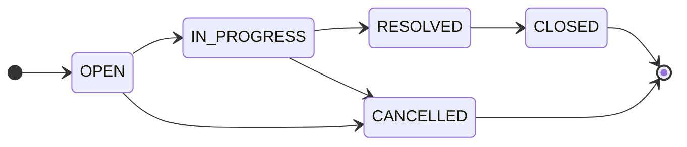
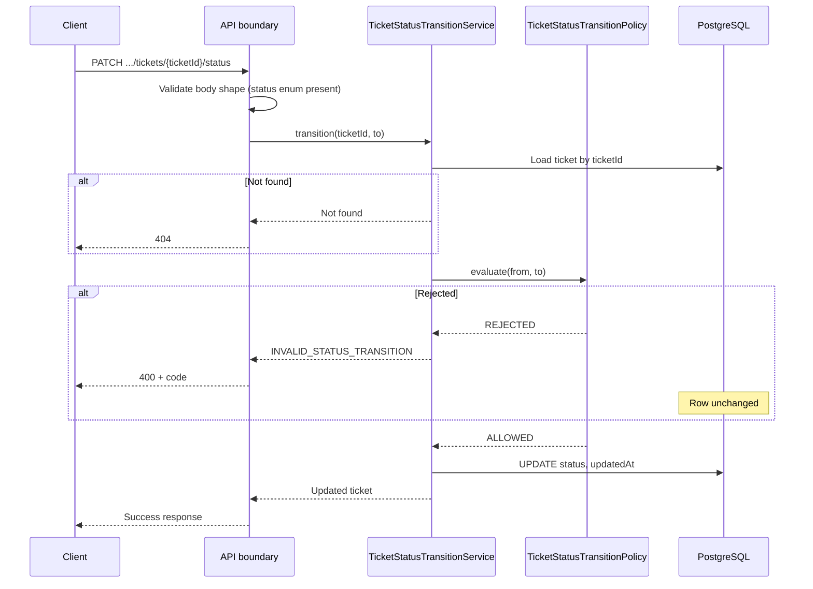

# c2-ticket.ai — Backend State-Transition Mechanism

**Sources:** [requirements.md](requirements.md), [architecture.md](architecture.md), [data-model.md](data-model.md)  
**Document type:** Design for status transitions (no implementation)  
**Authority:** Backend domain policy only; controllers and UI are not the source of truth.

---

## 1. Purpose

Define how ticket **status** changes are validated, invoked over HTTP, rejected, and tested. All other ticket field updates are **out of scope** for this mechanism except where the general PATCH must **reject** a `status` field.

---

## 2. Transition matrix (locked)

**Same-state is always rejected** (e.g. `OPEN` → `OPEN`), including when the client sends the current status explicitly.

| From \ To | `IN_PROGRESS` | `RESOLVED` | `CLOSED` | `CANCELLED` |
|-----------|:-------------:|:----------:|:--------:|:-----------:|
| **OPEN** | Allow | Reject | Reject | Allow |
| **IN_PROGRESS** | Reject | Allow | Reject | Allow |
| **RESOLVED** | Reject | Reject | Allow | Reject |
| **CLOSED** | Reject | Reject | Reject | Reject |
| **CANCELLED** | Reject | Reject | Reject | Reject |

Compact allowed edges:

```
OPEN          → IN_PROGRESS | CANCELLED
IN_PROGRESS   → RESOLVED      | CANCELLED
RESOLVED      → CLOSED
CLOSED        → (none)
CANCELLED     → (none)
```

`CLOSED` and `CANCELLED` are **terminal**: no outgoing transitions.



---

## 3. Domain components

### 3.1 `TicketStatusTransitionPolicy` (pure domain policy)

| Property | Rule |
|----------|------|
| **Purity** | No I/O: no database, HTTP, clocks, or Spring dependencies |
| **Input** | Current status (`from`), requested status (`to`) — both enum values from [data-model.md](data-model.md) §2.2 |
| **Output** | **Allow** or **Reject** (e.g. result type or exception type defined in domain module) |
| **Logic** | Encodes the matrix in §2; **reject** if `from == to`; **reject** if `from` is `CLOSED` or `CANCELLED`; **reject** if `(from, to)` is not an allowed edge; otherwise **allow** |

This class is the **only** place where the transition graph is defined. No duplicate matrices in controllers, DTOs, or UI.

**Suggested API shape (illustrative, not code):**

- `Decision evaluate(TicketStatus from, TicketStatus to)` → `ALLOWED` | `REJECTED`

Optional: `REJECTED` carries a stable reason code for mapping to HTTP (e.g. `INVALID_STATUS_TRANSITION`) at the application boundary.

### 3.2 `TicketStatusTransitionService` (application / domain service)

| Step | Action |
|------|--------|
| 1 | Resolve ticket by `ticketId` (business key). If missing → **404** (not covered by transition policy; separate not-found handling). |
| 2 | Read current `status` from loaded ticket (`from`). |
| 3 | Invoke **`TicketStatusTransitionPolicy.evaluate(from, to)`** **before** any persistence. |
| 4 | On **reject** → return failure mapped to **§5**; **do not** UPDATE the row. |
| 5 | On **allow** → persist new `status`, update `updatedAt`, complete transaction. |
| 6 | On **successful** commit → trigger **ingestion** refresh per [architecture.md](architecture.md) (status change is a ticket change). |

The transition service is the **only** application entry point that mutates `status` in the database.

### 3.3 What must **not** enforce transitions

| Layer | Rule |
|-------|------|
| **Controller** | Maps HTTP ↔ service DTOs; does not branch on allowed edges |
| **UI** | May hide controls for UX; **not** authoritative |
| **General ticket PATCH handler** | Must **not** accept `status`; see §4.2 |
| **Repository** | No graph logic; only load/save |

---

## 4. HTTP surface (locked)

### 4.1 Dedicated status endpoint (only path that changes status)

| Item | Value |
|------|--------|
| Method / path | **`PATCH /api/v1/tickets/{ticketId}/status`** |
| Path param | `ticketId` — public key (`^TKT-[0-9]+$`) |
| Body | JSON containing target **`status`** only (enum string). Other fields ignored or rejected per API validation spec. |
| Success | **200** (or **204** if body omitted — pick one in API spec; persistence still occurs) with updated ticket representation |
| Unknown ticket | **404** |
| Illegal transition | **400** with body **`code`: `INVALID_STATUS_TRANSITION`** — see §5 |

Flow:

```
Client → API boundary (shape) → TicketStatusTransitionService
       → TicketStatusTransitionPolicy (before persist)
       → repository UPDATE (only if allowed)
```

### 4.2 General field PATCH — `status` forbidden

| Item | Rule |
|------|------|
| Path | e.g. `PATCH /api/v1/tickets/{ticketId}` (exact path for general update defined in API spec) |
| Body contains `status` | **Reject** — do not partially apply other fields unless a separate spec says otherwise |
| Preferred behavior | **400** with a distinct error code (e.g. `STATUS_CHANGE_NOT_ALLOWED_ON_THIS_ENDPOINT`) so clients are steered to §4.1 |

Rationale: a single write path for status guarantees the transition service and policy always run.

### 4.3 Create ticket

New tickets receive **`OPEN`** per [data-model.md](data-model.md); create payload **must not** accept client-supplied `status` (or it is ignored/overridden server-side). Status graph first applies on the dedicated PATCH status endpoint.

---

## 5. Illegal transitions — HTTP and persistence

| Condition | HTTP | Response `code` | Database |
|-----------|------|-----------------|----------|
| Policy rejects `(from, to)` | **400 Bad Request** | **`INVALID_STATUS_TRANSITION`** | **No change** to ticket row (status unchanged) |
| Same-state request | **400** | **`INVALID_STATUS_TRANSITION`** | **No change** |
| Transition from `CLOSED` or `CANCELLED` | **400** | **`INVALID_STATUS_TRANSITION`** | **No change** |

**Response body (minimal contract):**

| Field | Value |
|-------|--------|
| `code` | `INVALID_STATUS_TRANSITION` |
| Optional | Human-readable `message`, `from`, `to` for clients and logs |

**Transactional rule:** Policy check and UPDATE occur in one application transaction. On reject, the service returns before issuing an UPDATE (or rolls back if combined with other work). Tests should assert **pre- and post-status equal** on reject.

---

## 6. End-to-end transition flow



---

## 7. Testing strategy

Tests fall into **unit** (policy), **service/integration** (DB + policy), and **HTTP** (MockMvc or equivalent).

### 7.1 `TicketStatusTransitionPolicy` — unit tests

**Every legal edge** (5 cases) — expect **ALLOWED**:

| # | From | To |
|---|------|-----|
| L1 | `OPEN` | `IN_PROGRESS` |
| L2 | `OPEN` | `CANCELLED` |
| L3 | `IN_PROGRESS` | `RESOLVED` |
| L4 | `IN_PROGRESS` | `CANCELLED` |
| L5 | `RESOLVED` | `CLOSED` |

**Every illegal edge** — expect **REJECTED** (exhaustive pairwise among five states minus legal and same-state):

| # | From | To | Reason |
|---|------|-----|--------|
| I1 | `OPEN` | `RESOLVED` | Not in matrix |
| I2 | `OPEN` | `CLOSED` | Not in matrix |
| I3 | `IN_PROGRESS` | `OPEN` | Not in matrix |
| I4 | `IN_PROGRESS` | `CLOSED` | Not in matrix |
| I5 | `RESOLVED` | `OPEN` | Not in matrix |
| I6 | `RESOLVED` | `IN_PROGRESS` | Not in matrix |
| I7 | `RESOLVED` | `CANCELLED` | Not in matrix |
| I8 | `CLOSED` | `OPEN` | Terminal |
| I9 | `CLOSED` | `IN_PROGRESS` | Terminal |
| I10 | `CLOSED` | `RESOLVED` | Terminal |
| I11 | `CLOSED` | `CLOSED` | Same-state |
| I12 | `CLOSED` | `CANCELLED` | Terminal |
| I13 | `CANCELLED` | `OPEN` | Terminal |
| I14 | `CANCELLED` | `IN_PROGRESS` | Terminal |
| I15 | `CANCELLED` | `RESOLVED` | Terminal |
| I16 | `CANCELLED` | `CLOSED` | Terminal |
| I17 | `CANCELLED` | `CANCELLED` | Same-state |

**Same-state** (non-terminal) — expect **REJECTED**:

| # | From | To |
|---|------|-----|
| S1 | `OPEN` | `OPEN` |
| S2 | `IN_PROGRESS` | `IN_PROGRESS` |
| S3 | `RESOLVED` | `RESOLVED` |

**Terminal states** — any request to leave terminal status is rejected (covered by I8–I16); additionally assert **every** target enum value from `CLOSED` and `CANCELLED` is rejected.

Implementation note: parameterized tests with `(from, to, expected)` keep the matrix single-sourced if the test table is generated from the same definition as the policy (optional refactor; policy class remains one source in production code).

### 7.2 `TicketStatusTransitionService` — integration tests

For a seeded ticket in each non-terminal `from` state:

| Case | Assert |
|------|--------|
| Legal transition | `status` in DB equals `to`; `updatedAt` advanced |
| Illegal transition | `status` unchanged; no side effects that imply success |
| Same-state | `status` unchanged |

Use real repository against test database (e.g. Testcontainers PostgreSQL).

### 7.3 HTTP mapping tests

| Scenario | Request | Expected |
|----------|---------|----------|
| Legal edge | `PATCH /api/v1/tickets/TKT-1001/status` with valid `to` | **2xx**; body shows new status |
| Illegal edge | PATCH with disallowed `to` | **400**; JSON `code` == **`INVALID_STATUS_TRANSITION`**; subsequent GET shows old status |
| Same-state | PATCH with `to` == current | **400**; `INVALID_STATUS_TRANSITION` |
| Terminal | Ticket `CLOSED` or `CANCELLED`, any PATCH status | **400**; `INVALID_STATUS_TRANSITION` |
| Wrong endpoint | `PATCH /api/v1/tickets/TKT-1001` with `"status": "CLOSED"` | **400**; distinct code (§4.2); status unchanged |
| Missing ticket | PATCH unknown `ticketId` | **404** |

Spy or wiremock **ingestion** on legal transitions only if tests cover full architecture flow (optional layer).

### 7.4 Regression guard

| Guard | Intent |
|-------|--------|
| Single policy class | ArchUnit or module rule: only `TicketStatusTransitionPolicy` contains transition pairs |
| Matrix parity | Documented matrix (§2) matches policy test table (§7.1) |

---

## 8. Traceability

| Source | This spec |
|--------|-----------|
| requirements §5 | Matrix and terminal states |
| architecture §5–§6 | Policy + service before persist; backend authority |
| data-model §2.2 | Enum values and initial `OPEN` |
| Stakeholder prompt | `TicketStatusTransitionPolicy`, dedicated PATCH path, `INVALID_STATUS_TRANSITION`, general PATCH rejects `status` |

---

## Document control

| Field | Value |
|-------|--------|
| Version | 1.0 |
| Status | Locked |
| Next step | Implement policy + service; wire controller to §4.1 only |