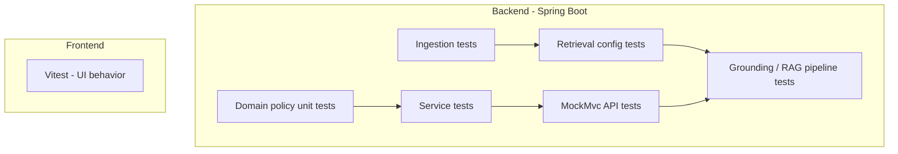

# c2-ticket.ai — Test Strategy

**Sources:** [requirements.md](requirements.md), [state-machine.md](state-machine.md), [api-contract.md](api-contract.md), [rag-api-contract.md](rag-api-contract.md), [rag-ingestion.md](rag-ingestion.md), [evaluation-strategy.md](evaluation-strategy.md)  
**Document type:** Verification approach (no application code in this document)

---

## 1. Goals

| Goal | Trace |
|------|--------|
| Backend state machine is authoritative | [state-machine.md](state-machine.md) §7 |
| Ticket and RAG API contracts remain stable | [api-contract.md](api-contract.md), [rag-api-contract.md](rag-api-contract.md) |
| RAG retrieval order and config (top-K, threshold) | [rag-ingestion.md](rag-ingestion.md) §10 |
| Grounding gate and no LLM on empty keep-set | [requirements.md](requirements.md), [rag-api-contract.md](rag-api-contract.md) |
| UI filter and status/RAG display behavior | [ui-flow.md](ui-flow.md) |

---

## 2. Test layers

| Layer | Scope | Primary tools |
|-------|--------|---------------|
| **Domain policy unit** | `TicketStatusTransitionPolicy`: every legal/illegal edge, same-state, terminal ([state-machine.md](state-machine.md) §7.1) | JUnit 5, parameterized cases |
| **Service tests** | Ticket transition service, ticket PATCH, comment create; policy invoked before persist; illegal transition leaves DB unchanged | Spring test slice or `@DataJpaTest` + service |
| **MockMvc API tests** | Full HTTP contract: [api-contract.md](api-contract.md), status endpoint, comment endpoints; error envelope shape | `@WebMvcTest` / `@SpringBootTest` + MockMvc |
| **Ingestion tests** | Post-commit ingest, chunking/fingerprint behavior, replace semantics; **in-memory vector store** stub (not PGVector) | Integration tests with test doubles |
| **Retrieval tests** | Prove **top-K** and **similarity-threshold** come from `rag.retrieval` config — change properties, assert different keep-set; order **top-K then threshold** | `@SpringBootTest` + property override + in-memory vectors |
| **Grounding tests** | Empty keep-set → no LLM call (mock/spy); post-generation gate downgrade; cite keep-set only | Pipeline test with deterministic generator stub |
| **Frontend Vitest** | Client keyword filter on list; status buttons per current status; RAG **ANSWER** / **NO_MATCH** / **ERROR** rendering | Vitest + component/harness tests |

---

## 3. Default test profile (CI-safe)

**Profile name (suggested):** `test` (active by default in `src/test`).

| Setting | Default test value | Rationale |
|---------|-------------------|-----------|
| Database | **H2** (in-memory) | No PostgreSQL required in CI |
| Flyway | **Off** | |
| Schema | **Hibernate `create-drop`** | Fast bootstrap |
| Embeddings | **Deterministic stub** (fixed vector from text hash or canned vectors) | No **Ollama** |
| Vector store | **In-memory** implementation of vector index port | No **PGVector** in default suite |
| LLM / generator | **Deterministic stub** (scripted responses for tests) | Reproducible grounding tests |
| RAG retrieval | Load `rag.retrieval.top-k` / `similarity-threshold` from `application-test.yml` | Prove config wiring |

**CI rule:** Default `./mvnw test` (or Gradle equivalent) must pass **without** Ollama, Docker PostgreSQL, or PGVector.

### 3.1 What default suite must cover

| Area | Examples |
|------|----------|
| State machine | Matrix from [state-machine.md](state-machine.md) §7.1–7.3 |
| Ticket API | Create rejects `ticketId`/`status`; PATCH forbids `status`; 404 `TICKET_NOT_FOUND` |
| RAG API envelope | All keys present; `NO_MATCH` empty citations; see [evaluation-strategy.md](evaluation-strategy.md) |
| Ingestion | Trigger on create/update/comment/status (verify ingest hook called); fingerprint skip optional |
| Retrieval | With `top-k=2` vs `5`, different candidate count before threshold |

---

## 4. Optional integration profile (not CI-gated by default)

**Profile name (suggested):** `it-ollama-pg` (or `integration`).

| Setting | Value |
|---------|--------|
| Database | Real **PostgreSQL** with **PGVector** |
| Embeddings | **Ollama** `nomic-embed-text` @ `http://localhost:11434` per [rag-ingestion.md](rag-ingestion.md) |
| Flyway | On (when migrations exist) |

| Gate | Requirement |
|------|-------------|
| Activation | Explicit: env var (e.g. `RUN_INTEGRATION=true`), Maven/Gradle profile, or tagged `@Tag("integration")` |
| CI | **Excluded** from default pipeline unless optional job with services |
| Documentation | README: how to run locally with Ollama + Postgres |

---

## 5. Frontend Vitest scope

Align with [ui-flow.md](ui-flow.md):

| Test theme | Assert |
|------------|--------|
| **List filters** | Changing status/priority/assignee/category builds correct query string; API mock receives AND params |
| **Keyword search** | Does **not** add API params; filters local array only |
| **Status actions** | From `OPEN`, only `IN_PROGRESS` and `CANCELLED` buttons; from `CLOSED`, none |
| **Status API error** | `INVALID_STATUS_TRANSITION` shows error, status display unchanged |
| **RAG display** | Mock `outcome: ANSWER` shows text + citations; `NO_MATCH` shows escalation, no answer; `ERROR` shows `error` block |

Use MSW or fetch mocks with fixtures from [rag-api-contract.md](rag-api-contract.md) examples.

---

## 6. Contract and evaluation tests

| Type | Location / runner |
|------|-------------------|
| Golden eval cases | `src/test/resources/eval/` — see [evaluation-strategy.md](evaluation-strategy.md) |
| Contract shape | JSON Schema or assertion tests that ticket errors and RAG envelopes match spec keys |

Run golden cases in **grounding** / **RAG pipeline** tests using deterministic generator stub where the case supplies `badGeneratorOutput`.

---

## 7. Test data conventions

| Item | Convention |
|------|------------|
| `ticketId` in tests | `TKT-1001`, `TKT-1002`, … matching regex |
| Timestamps | Fixed clock or `2026-01-01T00:00:00Z` in assertions |
| UUID comments | Valid v4 strings in fixtures |

---

## 8. Out of scope (default suite)

| Item | Notes |
|------|--------|
| Load / performance | Not in v1 test strategy |
| Auth | No tests until auth exists |
| Real LLM quality | Optional profile only; default uses stubs + [evaluation-strategy.md](evaluation-strategy.md) |

---

## Document control

| Field | Value |
|-------|--------|
| Version | 1.0 |
| Depends on | specs listed in §1 |