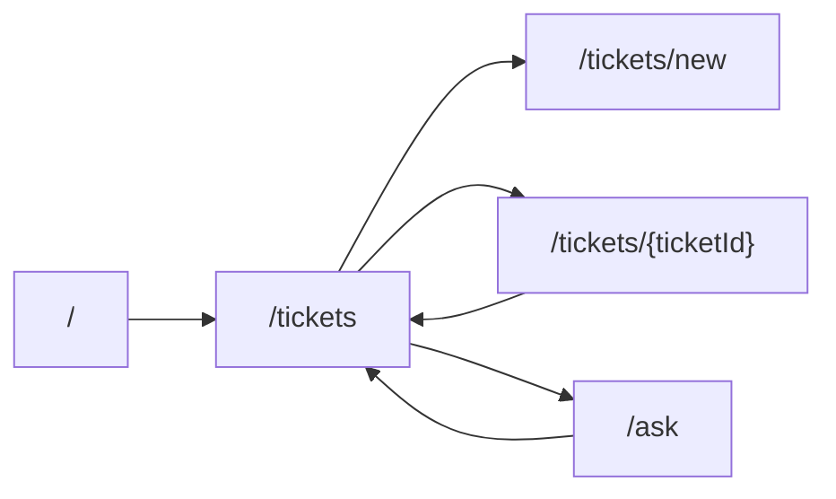

# c2-ticket.ai — UI Flow Specification

**Sources:** [api-contract.md](api-contract.md), [state-machine.md](state-machine.md), [rag-api-contract.md](rag-api-contract.md)  
**Document type:** Frontend screens and behavior (no implementation code)  
**Audience:** Single generic user; **no auth UI** in v1.

---

## 1. Navigation

| Route (logical) | Screen | Notes |
|-----------------|--------|--------|
| `/` (home) | **Redirect** | Always redirect to **ticket list** |
| `/tickets` | Ticket list | Default landing |
| `/tickets/new` | Create ticket | |
| `/tickets/{ticketId}` | Ticket detail | |
| `/ask` | Ask AI | RAG query |

Global nav (minimal): links to **Tickets** and **Ask AI**. No login, profile, or settings for v1.



---

## 2. Ticket list

### 2.1 Data loading

| Item | Behavior |
|------|----------|
| API | `GET /api/v1/tickets` with optional query params |
| Server filters | **`status`**, **`priority`**, **`assignee`**, **`category`** only ([api-contract.md](api-contract.md) §4.2) |
| Combination | AND — only params the user sets are sent |

### 2.2 Table columns

Each row shows:

| Column | Source field |
|--------|----------------|
| Ticket ID | `ticketId` |
| Title | `title` |
| Status | `status` |
| Priority | `priority` |
| Assignee | `assignee` (empty state if null) |
| Created | `createdAt` |

Row click or explicit control navigates to **ticket detail** for that `ticketId`.

### 2.3 Filter UI

| Control | Maps to query param |
|---------|---------------------|
| Status dropdown | `status` |
| Priority dropdown | `priority` |
| Assignee text/select | `assignee` |
| Category text/select | `category` |

**Apply filters:** Refetch from API when user applies or clears filters.

### 2.4 Keyword search (client-side only)

| Rule | Detail |
|------|--------|
| API | **No** keyword parameter — not sent to backend |
| Behavior | After each successful list fetch, filter the **in-memory result array** by user-entered keyword |
| Match scope | **Client-defined** substring match over visible columns (at minimum `ticketId`, `title`, `assignee`, `category`; recommend include `status`/`priority` as strings) |
| Empty keyword | Show full fetched list (subject to server filters) |

**Caveat (v1):** Keyword search does not search tickets absent from the current filtered API response. No pagination UI — entire filtered set is one fetch ([api-contract.md](api-contract.md)).

### 2.5 Pagination

**None.** Display all rows returned by the API (after client keyword filter).

### 2.6 Actions

| Action | Navigation / API |
|--------|------------------|
| Create ticket | Go to **create ticket** screen |
| Ask AI | Go to **Ask AI** screen |

---

## 3. Create ticket

### 3.1 Form fields

| Field | Required | API field |
|-------|----------|-----------|
| Title | Yes | `title` |
| Description | No | `description` |
| Priority | No (default MEDIUM) | `priority` |
| Assignee | No | `assignee` |
| Category | No | `category` |

**Do not** show or collect `ticketId`, `status`, or `resolutionNotes`.

### 3.2 Submit

| Step | Behavior |
|------|----------|
| API | `POST /api/v1/tickets` |
| Success **201** | Navigate to **ticket detail** for returned `ticketId` |
| **400** `VALIDATION_ERROR` | Show `error.message` and `details` on fields |

---

## 4. Ticket detail

Load: `GET /api/v1/tickets/{ticketId}` — **404** `TICKET_NOT_FOUND` → message and link back to list.

### 4.1 Display and edit fields

Editable via **save** (partial update):

| Field | API |
|-------|-----|
| Title | `PATCH /api/v1/tickets/{ticketId}` |
| Description | same |
| Priority | same |
| Assignee | same |
| Category | same |
| Resolution notes | `resolutionNotes` |

Read-only display: `ticketId`, `status`, `createdAt`, `updatedAt`.

**Forbidden:** Changing `status` on general PATCH — UI must not send `status` in PATCH body ([state-machine.md](state-machine.md), [api-contract.md](api-contract.md) §4.4). If user somehow triggers it, show server `STATUS_CHANGE_NOT_ALLOWED_ON_THIS_ENDPOINT`.

### 4.2 Status actions

| Principle | Detail |
|-----------|--------|
| UX | Show **only buttons** for transitions **allowed from current status** |
| Authority | **Server** enforces via `PATCH /api/v1/tickets/{ticketId}/status`; UI hints are not sufficient |

**Buttons by current status:**

| Current status | Actions shown (target status) |
|----------------|-------------------------------|
| `OPEN` | → `IN_PROGRESS`, → `CANCELLED` |
| `IN_PROGRESS` | → `RESOLVED`, → `CANCELLED` |
| `RESOLVED` | → `CLOSED` |
| `CLOSED` | *(none)* |
| `CANCELLED` | *(none)* |

| Step | Behavior |
|------|----------|
| User clicks action | `PATCH .../status` with `{ "status": "<target>" }` |
| **200** | Refresh detail; update read-only status |
| **400** `INVALID_STATUS_TRANSITION` | Show error; **do not** optimistically update status |

### 4.3 Comments

| Action | API |
|--------|-----|
| Load | `GET /api/v1/tickets/{ticketId}/comments` — chronological **ascending** `createdAt` |
| Add | `POST .../comments` with `author`, `content` |

**Add comment form:** `content` required; `author` optional.

**Success 201:** Append or re-fetch list; show `id` (UUID), `author`, `content`, `createdAt`.

---

## 5. Ask AI

### 5.1 Interaction

| Item | Value |
|------|--------|
| Input | Single query text field + submit |
| API | `POST /api/v1/rag/query` with `{ "query": "<text>" }` |
| Blank submit | Client should trim; empty → avoid call or handle **400** from API |

### 5.2 Rendering by `outcome`

Per [rag-api-contract.md](rag-api-contract.md) — all envelope keys exist; UI branches on **`outcome`**.

#### `ANSWER`

| Element | Source |
|---------|--------|
| Answer body | `answer.text` |
| Citations list | `citations[]` — each `ticketId` + `title`; link each `ticketId` to **ticket detail** |
| Confidence (optional display) | `confidence.score`, `confidence.basis` |
| Escalation | `escalation.recommended === false` — typically hide or show “no escalation” |

#### `NO_MATCH`

| Element | Source |
|---------|--------|
| Primary message | `noMatch.message` and/or `noMatch.code` (`NO_RELEVANT_TICKETS`, `GROUNDING_GATE_FAILED`, …) |
| No answer block | `answer` is null — **do not** show generated text |
| Citations | Empty array — show none |
| Escalation | `escalation.recommended === true` — prominent “try rephrasing / contact support” style copy using `escalation.reason` when present |

#### `ERROR`

| Element | Source |
|---------|--------|
| Error | `error.code`, `error.message` |
| No answer | `answer` null |
| Escalation | `escalation` null — use generic retry messaging |
| Distinct styling | Visually **different** from `NO_MATCH` (e.g. infrastructure vs. no results) |

**HTTP:** `ANSWER` and `NO_MATCH` use **200** with envelope; `ERROR` typically **503** with same envelope shape ([rag-api-contract.md](rag-api-contract.md) §9).

---

## 6. API error handling (tickets)

For ticket screens, **4xx** responses use [api-contract.md](api-contract.md) error envelope:

```json
{ "error": { "code", "message", "details": [] } }
```

Show `message` and map `details[].field` to form fields where applicable.

---

## 7. Explicit non-goals (v1 UI)

| Item | Status |
|------|--------|
| Authentication / login | **No UI** |
| Pagination controls | **No UI** |
| Delete ticket or comment | **No UI** (API has no delete) |
| RAG config (top-K, threshold) | **No UI** |
| Multi-user / roles | **No UI** |

---

## Document control

| Field | Value |
|-------|--------|
| Version | 1.0 |
| Depends on | api-contract, state-machine, rag-api-contract |